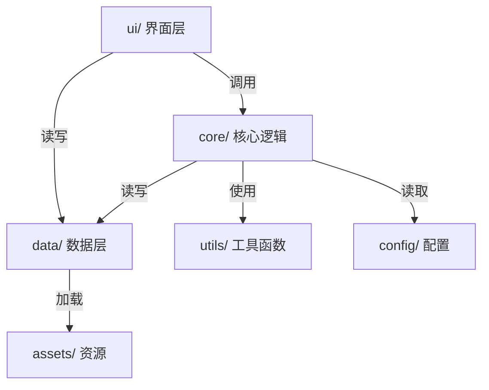

# 工程开发通用标准（增强版）(ENGINEERING_STANDARD_ENHANCED.md)

> 版本: v2.1 | 生效日期: 2026-08-09
> 基于: v2.0 工程开发通用标准
> 新增: §6.8 大文件拆分策略、§6.9 Agent 上下文预算分配、§19 故障排查速查表、§20 项目知识沉淀
> 适用范围: Agent 主导的所有工程项目（游戏、工具、Web 应用等）
> 目标: **可追溯、可回退、省 token、可克隆复现**

---

## 📑 目录

| § | 章节 |
|---|------|
| 0 | [核心原则](#0-核心原则不可违反) |
| 1 | [目录结构规范](#1-目录结构规范) |
| 2 | [FILE_INDEX.md — 文件索引规范](#2-file_indexmd--文件索引规范) |
| 3 | [CHANGELOG.md — 改动记录规范](#3-changelogmd--改动记录规范) |
| 4 | [Git 版本管理规范](#4-git-版本管理规范) |
| 5 | [SKILLS_USED.md — 依赖 Skill 清单](#5-skills_usedmd--依赖-skill-清单) |
| 6 | [Token 节约专项策略](#6-token-节约专项策略) |
| 7 | [代码标注规范](#7-代码标注规范) |
| 8 | [Agent 行为约束](#8-agent-行为约束) |
| 9 | [快速自检清单](#9-快速自检清单) |
| 10 | [模板文件](#10-模板文件) |
| 11 | [可移植性规范](#11-可移植性规范) |
| 12 | [错误处理与日志规范](#12-错误处理与日志规范) |
| 13 | [命名与代码风格规范](#13-命名与代码风格规范) |
| 14 | [安全基线](#14-安全基线) |
| 15 | [轻量测试策略](#15-轻量测试策略) |
| 16 | [项目成熟度分级](#16-项目成熟度分级) |
| 17 | [常见反模式与陷阱](#17-常见反模式与陷阱) |
| 18 | [协作与 Code Review 清单](#18-协作与-code-review-清单) |
| 19 | [故障排查速查表](#19-故障排查速查表) |
| 20 | [项目知识沉淀](#20-项目知识沉淀) |
| 附录 | [A~F + Python 对照表](#附录-afile_indexmd-完整模板含依赖图职责表) |

---

## 0. 核心原则（不可违反）

| # | 原则 | 落地方式 |
|---|------|----------|
| 1 | 代码必有标注 | 每个文件、函数、关键区块必须有注释说明用途 |
| 2 | 文件作用有索引 | 每个工程根目录维护 `FILE_INDEX.md`，开发前先遍历 |
| 3 | 改动单独记录 | 每次改动写入 `CHANGELOG.md`，格式见 §3 |
| 4 | 随时可回退 | Git 提交粒度 = 一次逻辑改动；见 §4 回退流程 |
| 5 | Skill 可复现 | 工程内 `SKILLS_USED.md` 记录所有依赖 skill 及安装方式 |
| 6 | 目录有规范 | 临时脚本/调试代码不得散落根目录，统一放 `scratch/` 并加 `.gitignore` |
| 7 | Token 节约优先 | 见 §6 专项策略 |
| 8 | 模块关系可视化 | `FILE_INDEX.md` 内含 Mermaid 依赖图 + 模块职责表 |
| 9 | 最近更改可一眼查看 | `CHANGELOG.md` 顶部维护「最近更改摘要」区块 |
| 10 | 可移植性 | 克隆到任何机器即可运行，零绝对路径、零硬编码环境依赖 |
| 11 | 错误不可静默 | 所有异常必须被捕获并记录，禁止空 catch / 吞异常 |
| 12 | 安全基线不降级 | 密钥零硬编码、输入必校验、依赖必审计 |

---

## 1. 目录结构规范

每个工程必须采用以下结构（未用到的目录可省略）：

```
project-name/
├── FILE_INDEX.md          # ★ 文件索引 + 依赖图 + 模块职责表（必建）
├── CHANGELOG.md           # ★ 改动记录 + 顶部最近更改摘要（必建）
├── SKILLS_USED.md         # ★ 依赖 skill 清单（必建）
├── README.md              # 工程说明、运行方式（含一键启动指引）
├── .gitignore
├── .env.example           # ★ 环境变量模板（提交，含字段说明，不含真实值）
├── .env                   # ★ 真实环境变量（gitignore，不进版本库）
├── package.json           # 依赖清单 + scripts（start/dev/test）
├── src/                   # 源码主目录
│   ├── core/              # 核心逻辑
│   ├── ui/                # 界面
│   ├── data/              # 数据层
│   └── utils/             # 工具函数
├── assets/                # 静态资源（图片、音频、配置）
├── docs/                  # 设计文档、API 文档
├── tests/                 # 测试脚本
├── scripts/               # 构建/部署脚本（含 setup 脚本）
├── scratch/               # ★ 临时调试脚本（gitignore，不进版本库）
└── config/                # 配置文件（默认值，可被 .env 覆盖）
```

### 1.1 规则
- **根目录只放规范文件**（`*.md`、`package.json`、`.gitignore` 等），源码一律进 `src/`
- 临时调试脚本（如 `debug_xxx.js`、`check_xxx.py`）一律放 `scratch/`，并在 `.gitignore` 中排除
- 同类文件不得编号堆叠（禁止 `v1_extract.js` `v2_extract.js` `v3_extract.js`），用 Git 分支/Tag 管理版本

---

## 2. FILE_INDEX.md — 文件索引规范

**每个工程根目录必建**。Agent 每次开发前必须先读此文件，再决定操作哪个文件。

### 2.1 格式模板

```markdown
<!-- FILE_INDEX — 项目名 -->

> 最后更新: 2026-08-09 10:45 | 由 Agent 更新

<!-- 源码文件 -->

| 文件路径 | 作用 | 关键函数/区块 | 依赖 |
|----------|------|---------------|------|
| src/core/engine.js | 游戏主循环 | update(), render(), loop() | src/utils/math.js |
| src/ui/menu.js | 主菜单界面 | showMenu(), handleClick() | src/core/engine.js |
| src/data/items.json | 物品数据表 | — | — |

<!-- 资源文件 -->

| 文件路径 | 类型 | 说明 |
|----------|------|------|
| assets/sprites/player.png | 图片 | 玩家精灵图 |
| assets/audio/bgm.mp3 | 音频 | 背景音乐 |

<!-- 配置文件 -->

| 文件路径 | 说明 |
|----------|------|
| config/game-config.json | 游戏数值配置 |
| .gitignore | Git 忽略规则 |
```

### 2.2 更新时机
- 新建文件时
- 删除文件时
- 文件主要功能变更时
- **每次开发会话结束时** 检查一遍

---

### 2.3 模块依赖关系图与模块职责（FILE_INDEX.md 内嵌）

**目的**：一眼看清模块间依赖方向、各模块职责边界，避免改一个模块不知道牵连哪些文件。Agent 开发前必读此区块，用户也可随时查看全局架构。

#### 2.3.1 依赖关系图（Mermaid）

在 `FILE_INDEX.md` 中，文件表格之后，必须包含一段 Mermaid 依赖图。**只画模块/目录级别**（不画到单个文件，否则图会爆炸），标注依赖方向和数据流。

````markdown
<!-- 模块依赖关系图 -->



> **读图规则**：箭头 A --> B 表示「A 依赖 B」。改动 B 时需检查所有指向 B 的模块。
````

#### 2.3.2 模块职责表

依赖图后紧跟职责表，每个模块/目录一行，说明：

````markdown
<!-- 模块职责表 -->

| 模块/目录 | 职责 | 对外暴露 | 依赖方向 | 改动影响范围 |
|-----------|------|----------|----------|-------------|
| core/ | 游戏主循环、状态管理 | update(), render() | → utils/, data/, config/ | 影响全部上层 |
| ui/ | 渲染界面、处理输入 | showMenu(), handleClick() | → core/ | 影响所有界面 |
| data/ | 物品/角色/关卡数据 | loadData(), saveData() | → assets/ | 影响数据引用方 |
| utils/ | 数学/随机/格式化工具 | clamp(), randomInt() | 无（叶子模块） | 影响所有引用方 |
| config/ | 数值/规则配置 | — | 无 | 影响读取配置的模块 |
````

#### 2.3.3 更新时机
- 新增模块/目录时
- 模块间依赖关系变化时
- 模块职责变更时
- 每次开发会话结束时与 FILE_INDEX 一起检查

#### 2.3.4 影响面快速判断规则

Agent 改动某个文件时，按以下步骤判断影响面：
1. 在依赖图中找到该文件所属模块
2. 查看该模块的「改动影响范围」
3. 查看依赖图中所有指向该模块的箭头（谁依赖我）
4. 逐一检查这些上游模块是否受影响

> 这一步替代了过去「全文搜索变量名」的笨办法，省 token。

---

## 3. CHANGELOG.md — 改动记录规范

**格式**：每次改动一个条目，最新在上。

```markdown
<!-- CHANGELOG — 项目名 -->

<!-- 📌 最近更改摘要 -->

> 此区块每次改动后更新，只保留最近 5 条摘要。详细记录见下方历史。

| 时间 | 类型 | 摘要 | 涉及模块 | 提交 |
|------|------|------|----------|------|
| 08-09 10:45 | fix | 修复碰撞检测Y轴穿透 | core/engine.js | a1b2c3d |
| 08-09 09:30 | feat | 新增物品系统(20个物品) | data/, core/ | e4f5g6h |
| 08-08 22:10 | refactor | 菜单逻辑拆分 | ui/menu.js | i7j8k9l |
| 08-08 18:00 | fix | 修复背景音乐不循环 | audio/ | m0n1o2p |
| 08-08 14:20 | feat | 新增存档功能 | core/save.js | q3r4s5t |

---

<!-- [2026-08-09 10:45] 修复玩家碰撞检测 -->
- **文件**: `src/core/engine.js`
- **区块**: `update()` 函数内，碰撞检测段（L120-L145）
- **函数**: `checkCollision()`
- **改动**: 修复 Y 轴判定使用 > 而非 >= 导致边缘穿透
- **原因**: 测试发现玩家站在平台边缘会掉落
- **提交**: `a1b2c3d` (commit hash)

<!-- [2026-08-09 09:30] 新增物品系统 -->
- **文件**: `src/data/items.json` (新建), `src/core/inventory.js` (新建)
- **区块**: 全文件
- **改动**: 添加 20 个物品定义和背包管理逻辑
- **提交**: `e4f5g6h`
```

### 3.1 必填字段
- **文件**: 改了哪个文件（路径）
- **区块**: 文件内大致位置（函数名 / 行号范围 / 区域名）
- **改动**: 一句话说清楚改了什么
- **提交**: Git commit hash（短即可）

### 3.2 选填字段
- **函数**: 涉及的函数名
- **原因**: 为什么改

### 3.3 最近更改摘要（CHANGELOG.md 顶部固定区块）

**目的**：用户和 Agent 打开 CHANGELOG 第一眼就能看到「最近改了什么、当前状态如何」，无需翻历史条目。

在 `CHANGELOG.md` 的**最顶部**（所有历史条目之上）维护一个固定区块，格式见上方模板中的 `## 📌 最近更改摘要`。

#### 3.3.1 维护规则
- **只保留最近 5 条**：第 6 条移入下方历史区
- **每次改动后立即更新**：不是会话结束时，是改完就更新
- **摘要一行话**：不超过 20 字，细节在历史条目里
- **涉及模块**：填模块/目录名，对应 §2.3 的模块职责表
- Agent 每次开发前读此区块，3 秒了解项目当前状态

---

## 4. Git 版本管理规范

### 4.1 提交粒度
- **一次提交 = 一次逻辑改动**（修一个 bug / 加一个功能 / 重构一个模块）
- 禁止一次提交塞入多个不相关改动
- 提交信息格式：`<type>: <简述>`，如 `fix: 碰撞检测Y轴判定`、`feat: 物品系统`

### 4.2 提交信息模板
```
<type>: <简述>

文件: src/core/engine.js
区块: checkCollision() L120-L145
改动: >= 替换 >
```

### 4.3 回退流程

当用户说「回退到 XXX 之前」时：

1. **查找提交**：`git log --oneline -20` 找到目标 commit
2. **确认范围**：向用户展示目标 commit 及其前一个 commit，确认要回退到的点
3. **选择方式**：
   - **保留改动到工作区**：`git reset --soft <commit>`（改动仍在，可重新提交）
   - **彻底回退**：`git reset --hard <commit>`（⚠️ 需用户确认，不可逆）
   - **新建回退提交**（推荐）：`git revert <commit>`（保留历史，安全）
4. **更新 FILE_INDEX.md 和 CHANGELOG.md**：记录回退操作

### 4.4 分支策略
- `main`: 可运行版本
- `dev`: 开发中
- `feat/<名称>`: 具体功能分支
- Agent 默认在 `dev` 或功能分支工作，`main` 仅在用户确认后合并

### 4.5 Tag 策略
- 每个里程碑打 Tag：`v0.1`、`v0.2`...
- 用户说「回到 v0.2」时直接 `git checkout v0.2`

---

## 5. SKILLS_USED.md — 依赖 Skill 清单

**目的**：克隆本仓库的 Agent / 人类无需依赖本机全局 skill 目录即可安装。

### 5.1 格式模板

````markdown
<!-- SKILLS_USED — 项目名 -->

> 以下 skill 为本项目开发所依赖，克隆后需按此安装。

<!-- 必需 Skill -->

| Skill 名称 | 用途 | 安装方式 | 版本 |
|------------|------|----------|------|
| xlsx | 读写 Excel 数据 | `skillhub_install install_skill xlsx` | — |
| xbrowser | 浏览器自动化测试 | `skillhub_install install_skill xbrowser` | — |
| pdf | 生成 PDF 文档 | `skillhub_install install_skill pdf` | — |

<!-- 可选 Skill -->

| Skill 名称 | 用途 | 何时需要 |
|------------|------|----------|
| cloud-upload-backup | 备份到云 | 需要云存档时 |

## 安装一键脚本

```powershell
# 安装所有必需 skill
skillhub_install install_skill xlsx
skillhub_install install_skill xbrowser
skillhub_install install_skill pdf
```
````

### 5.2 更新时机
- 首次使用某个 skill 时
- 新增 skill 依赖时
- 每次开发会话结束时检查

---

## 6. Token 节约专项策略

### 6.1 开发前：先读索引，不全量扫描
```
❌ 错误：exec ls -R 然后逐个 read 每个文件
✅ 正确：read FILE_INDEX.md（含依赖图+职责表） → 定位目标文件 → 只读目标文件
```

### 6.2 修改时：精准编辑，不全文重写
```
❌ 错误：read 整个文件 → write 整个文件（覆盖）
✅ 正确：read 目标函数区域 → edit 精准替换该区域
```

### 6.3 调试时：scratch 目录 + .gitignore
- 临时调试脚本放 `scratch/`，不进 Git，不进 FILE_INDEX
- 调试完确认有用的逻辑迁入 `src/`，然后清理 `scratch/`

### 6.4 搜索时：用 git grep，不用全文扫描
```powershell
git grep "functionName"                    # 搜代码
git grep -n "TODO"                         # 搜标记
```

### 6.5 上下文管理
- 大文件只读需要的行范围（`read` 带 `offset` 和 `limit`）
- 避免重复读同一个文件（记住已读内容）
- 优先用 `edit` 的 `oldText/newText` 精准替换，不用 `write` 全量覆盖

### 6.6 影响面判断：查依赖图，不全文搜索
```
❌ 错误：改一个函数 → grep 全项目搜索所有引用
✅ 正确：查 §2.3 依赖图 → 找到模块 → 看「改动影响范围」→ 只检查上游模块
```

### 6.7 Agent 工作流（省 token 版）

```
用户提需求
  ↓
1. read FILE_INDEX.md（含依赖图+模块职责表，了解全局架构）
  ↓
2. read CHANGELOG.md 顶部「最近更改摘要」表（3秒了解项目当前状态）
  ↓
3. 查依赖图判断影响面：要改哪个模块？谁依赖它？需不需要改上游？
  ↓
4. 定位要改的文件，read 目标区域（非全文）
  ↓
5. edit 精准修改
  ↓
6. 测试/验证（最小必要范围）
  ↓
7. git add + commit（一次逻辑改动一个提交）
  ↓
8. 追加 CHANGELOG.md 历史条目 + 更新顶部「最近更改摘要」表
  ↓
9. 更新 FILE_INDEX.md（如有文件增删/依赖变化/职责变更）
  ↓
10. 更新 SKILLS_USED.md（如用到新 skill）
```

### 6.8 大文件拆分策略（Token 效率 - 架构层面）

> 现有 §6.1-§6.7 聚焦操作层面的 Token 节约，本节从架构层面预防 Token 浪费。

#### 6.8.1 文件行数上限

| 文件类型 | 建议上限 | 超过后处理 | 原因 |
|----------|----------|-----------|------|
| 源码文件 | 300 行 | 按职责拆分为多个文件 | Agent 读/改时只需加载相关部分 |
| 配置文件 | 200 行 | 按环境拆分（dev/prod/test）| 避免加载不相关配置 |
| 数据文件 | 500 行 | 按类别拆分，用索引文件汇总 | 减少单次读取的数据量 |
| 测试文件 | 400 行 | 按被测模块拆分 | 失败时只跑相关测试 |

#### 6.8.2 拆分原则

```javascript
// ❌ 反例：万能文件 600 行
// src/utils/helpers.js — 包含字符串处理、日期格式化、HTTP 请求、文件操作...

// ✅ 正例：按职责拆分
// src/utils/string.js      — 字符串处理（80 行）
// src/utils/date.js        — 日期格式化（60 行）
// src/utils/http.js        — HTTP 请求（120 行）
// src/utils/file.js        — 文件操作（90 行）
// src/utils/index.js       — 统一导出（20 行）
```

#### 6.8.3 索引文件模式

拆分后必须提供索引文件，避免使用者逐个导入：

```javascript
// src/utils/index.js
export { trim, slugify } from './string';
export { formatDate, parseDate } from './date';
export { get, post } from './http';
export { readJson, writeJson } from './file';
```

#### 6.8.4 数据文件拆分示例

```
// ❌ 反例：单个巨大 JSON
data/items.json          // 2000 行，所有物品

// ✅ 正例：按类别拆分 + 索引
data/items/
  ├── index.json         // 20 行，类别索引 + 文件映射
  ├── weapons.json       // 300 行，武器
  ├── armors.json        // 250 行，防具
  ├── consumables.json   // 180 行，消耗品
  └── materials.json     // 150 行，材料
```

`data/items/index.json`:
```json
{
  "categories": {
    "weapons": { "file": "weapons.json", "count": 45 },
    "armors": { "file": "armors.json", "count": 32 },
    "consumables": { "file": "consumables.json", "count": 28 },
    "materials": { "file": "materials.json", "count": 20 }
  }
}
```

> **省 Token 原理**：需要武器时只读 `weapons.json`，不加载全部 2000 行。

### 6.9 Agent 上下文预算分配

#### 6.9.1 单次会话 Token 分配建议

| 阶段 | 预算占比 | 用途 | 超时预警 |
|------|----------|------|----------|
| 架构理解 | 30% | 读 FILE_INDEX.md、依赖图、CHANGELOG 摘要 | 若读索引花了 50%+，说明索引不清晰 |
| 实际编码 | 50% | 读目标文件、编辑、调试 | 核心阶段，保证充足预算 |
| 测试验证 | 15% | 跑测试、验证结果 | 不可跳过，避免回归 |
| 文档更新 | 5% | 更新 CHANGELOG、FILE_INDEX | 最少但必须有 |

#### 6.9.2 预算异常诊断

```
现象：读文件就花了 70% token
  ↓
诊断：
  1. FILE_INDEX.md 是否过期？→ 索引失效导致全量扫描
  2. 文件是否超过行数上限？→ 需拆分（见 §6.8）
  3. 是否重复读同一文件？→ Agent 未缓存已读内容
  4. 是否用 grep 替代了依赖图？→ 应查 §2.3 模块依赖图

解决：按优先级修复索引 → 拆分文件 → 提醒 Agent 缓存
```

#### 6.9.3 长任务拆分策略

当预估任务需要多次会话时，提前规划拆分点：

```markdown
<!-- 任务拆分示例：重构物品系统 -->

<!-- 会话 1：准备阶段 -->
- 读 FILE_INDEX.md + CHANGELOG 摘要
- 读现有物品相关代码
- 写重构计划（存入 docs/refactor-plan.md）
- 提交：plan: 物品系统重构计划

<!-- 会话 2：数据层重构 -->
- 按 §6.8.4 拆分 items.json
- 更新数据加载逻辑
- 跑测试确认数据读取正常
- 提交：refactor: 拆分物品数据文件

<!-- 会话 3：业务层重构 -->
- 修改引用旧数据结构的代码
- 更新物品相关函数
- 跑全量测试
- 提交：refactor: 适配新数据结构

<!-- 会话 4：收尾 -->
- 更新 FILE_INDEX.md
- 更新 CHANGELOG.md
- 清理临时文件
- 提交：docs: 更新索引和文档
```

> **原则**：每个会话有明确交付物，避免「改到一半 token 用完」的烂尾状态。

---

## 7. 代码标注规范

### 7.1 文件头注释
每个源码文件开头必须有：
```javascript
/**
 * @file 文件用途简述
 * @author Agent / 人类
 * @created 2026-08-09
 * @depends 依赖的其他文件/模块
 */
```

### 7.2 函数注释
```javascript
/**
 * 检测两个矩形是否碰撞
 * @param {Rect} a - 矩形A
 * @param {Rect} b - 矩形B
 * @returns {boolean} 是否碰撞
 * @note 边缘判定使用 >= 而非 >
 */
function checkCollision(a, b) { ... }
```

### 7.3 区块注释
关键逻辑段落前加一行注释：
```javascript
// --- 碰撞检测核心逻辑 ---
// --- 物品掉落概率计算 ---
// --- HACK: 临时绕过 XXX，待修复 ---
```

### 7.4 改动标记
修改他人/旧代码时，在改动行旁加注释：
```javascript
// [2026-08-09 Agent] 修复: >= 替换 >
if (a.y >= b.y + b.h) { ... }
```

---

## 8. Agent 行为约束（写入 AGENTS.md 的补充条款）

以下条款 Agent 必须在每次开发任务中遵守：

1. **首次操作**：进入工程目录后，先 `read FILE_INDEX.md`（含依赖图+模块职责表），再 `read CHANGELOG.md` 顶部摘要区，不直接 ls / find
2. **影响面判断**：改动前查依赖图，确认上游受影响模块，不做全文搜索
3. **改前记录**：修改前确认当前 Git 状态干净（`git status`），有未提交改动先提醒用户
4. **改后记录**：每次改动后立即追加 CHANGELOG.md 历史条目 + 更新顶部摘要表 + git commit
5. **不堆版本**：禁止创建 `v1_xxx.js` `v2_xxx.js`，用 Git 管理版本
6. **不散落**：临时脚本一律进 `scratch/`
7. **回退优先**：用户不满意时，优先提供 Git 回退方案，而非"再改一版"
8. **Skill 记录**：用到新 skill 时立即更新 `SKILLS_USED.md`
9. **索引同步**：文件增删/依赖变化/职责变更后立即更新 `FILE_INDEX.md`（含依赖图和职责表）
10. **路径相对化**：所有路径必须相对项目根目录，禁止硬编码绝对路径，提交前执行 §11.3.4 自检
11. **可移植优先**：每次改动后思考「换一台机器这还能跑吗？」，若不能则修复
12. **异常必处理**：所有 try-catch 必须有意义处理，禁止空 catch，日志写入 `logs/` 目录
13. **密钥零硬编码**：代码中不得出现 API Key / Token / Password，一律走 `.env`
14. **输入必校验**：所有外部输入（用户输入、API 响应、文件读取）必须校验类型和范围
15. **先测后提**：修改核心逻辑后先跑 `npm test`，绿色才提交
16. **避免过分夸赞**：回答保持克制、客观，不堆砌溢美之词，直接陈述事实与判断
17. **默认双方都可能错**：Agent 的回答与用户的判断都不必然正确，对待所有问题反复推敲，准确性优先于迎合
18. **主动索要证据**：信息不足或存疑时，主动向用户索要补充信息、证据或澄清，不凭现有信息硬答、不臆测
19. **结构化输出**：回答分点分层、条理清晰，便于用户快速定位结论与依据

---

## 9. 快速自检清单

每次开发会话结束前，Agent 必须过一遍：

- [ ] FILE_INDEX.md 是否与实际文件一致？（含文件表 + 依赖图 + 模块职责表）
- [ ] CHANGELOG.md 是否记录了本次所有改动？（历史条目 + 顶部摘要表）
- [ ] Git 是否已提交？
- [ ] 临时脚本是否已清理或移入 scratch/？
- [ ] SKILLS_USED.md 是否更新？
- [ ] 代码注释是否齐全？
- [ ] 是否有版本堆叠文件（v1/v2/v3）需要清理？
- [ ] 是否有绝对路径硬编码？（grep 检查，见 §11.3）
- [ ] .env 是否被 gitignore？.env.example 是否已提交？
- [ ] 新机器克隆后能否 `一键启动`？（见 §11.5）
- [ ] 是否有空 catch / 吞异常？（见 §12.5）
- [ ] 核心逻辑是否有测试覆盖？（见 §15）
- [ ] 是否有硬编码密钥？（见 §14.1）
- [ ] 用户输入是否都有校验？（见 §14.2）

---

## 10. 模板文件

新建工程时，Agent 应一键生成以下文件：
- `FILE_INDEX.md`（空模板，含依赖图+模块职责表框架）
- `CHANGELOG.md`（空模板，含顶部「最近更改摘要」表框架）
- `SKILLS_USED.md`（空模板）
- `.gitignore`（含 `scratch/`、`node_modules/`、`*.tmp`、`.env` 等）
- `.env.example`（环境变量模板，含字段说明）
- `README.md`（工程说明 + 一键启动指引）
- `src/` 目录结构
- `tests/` 目录 + 最小测试框架文件（见 §15）
- `logs/` 目录 + `.gitkeep`（gitignore 日志文件，保留目录）

---

## 11. 可移植性规范

### 11.1 核心原则

> **克隆即可运行**：任何人/Agent 从 Git 克隆到任意机器后，执行一条命令即可启动项目，无需手动修改任何路径或配置。

### 11.2 环境隔离：三层配置

| 层级 | 文件 | 提交到 Git | 用途 |
|------|------|-----------|------|
| 默认值 | `config/default.json` | ✅ 是 | 项目默认配置，所有机器通用的安全默认值 |
| 环境变量 | `.env` | ❌ gitignore | 本机真实值（密钥、端口、路径前缀等），从 `.env.example` 复制 |
| 模板 | `.env.example` | ✅ 是 | 字段清单 + 说明，不含真实值，供新机器参照填写 |

**读取优先级**：`.env` > `config/default.json` > 代码内 fallback

### 11.3 路径规范

#### 11.3.1 禁止绝对路径

代码中**严禁**出现硬编码绝对路径：
```javascript
// ❌ 禁止
const dataPath = 'C:\\Users\\Administrator\\project\\data\\items.json';
const imgPath = '/home/user/project/assets/player.png';

// ✅ 正确：相对路径
const dataPath = 'data/items.json';
const imgPath = 'assets/player.png';
```

#### 11.3.2 项目根目录基准

所有相对路径以**项目根目录**为基准。在入口文件中定义一次 `PROJECT_ROOT`：
```javascript
// src/utils/paths.js — 唯一定义项目根目录的位置
const path = require('path');
// __dirname 向上回溯到项目根目录
const PROJECT_ROOT = path.resolve(__dirname, '..', '..');
const ASSETS_DIR = path.join(PROJECT_ROOT, 'assets');
const DATA_DIR = path.join(PROJECT_ROOT, 'data');
const CONFIG_DIR = path.join(PROJECT_ROOT, 'config');

module.exports = { PROJECT_ROOT, ASSETS_DIR, DATA_DIR, CONFIG_DIR };
```

其他文件引用：
```javascript
const { ASSETS_DIR } = require('../utils/paths');
const imgPath = path.join(ASSETS_DIR, 'player.png');
```

#### 11.3.3 跨平台路径

- **禁止**用 `\\` 或 `/` 拼接路径，必须用 `path.join()` 或 `path.sep`
- **禁止**假设操作系统（不写 `C:\\` 也不写 `/usr/local/`）
- Node.js 项目用 `path` 模块；Python 项目用 `os.path` 或 `pathlib`
```python
<!-- Python -->
from pathlib import Path
PROJECT_ROOT = Path(__file__).resolve().parent.parent
DATA_DIR = PROJECT_ROOT / 'data'
```

#### 11.3.4 Agent 自检命令

每次提交前 Agent 必须执行路径检查：
```powershell
# 检查是否有硬编码绝对路径（排除 node_modules 和 scratch）
# Windows 路径模式
git grep -n -E '[A-Z]:\\\\' -- ':!node_modules' ':!scratch'
# Unix 路径模式（排除 /tmp /usr 等）
git grep -n -E '/(home|Users|var|opt|etc)/' -- ':!node_modules' ':!scratch'
```
若有输出，必须修复为相对路径后再提交。

### 11.4 依赖锁定

#### 11.4.1 包管理
- `package.json`（或 `requirements.txt` / `go.mod`）必须提交到 Git
- **锁文件必须提交**：`package-lock.json` / `yarn.lock` / `pnpm-lock.yaml` / `poetry.lock`，确保不同机器装相同版本
- 禁止在代码中依赖全局安装的包（一切通过项目依赖）

#### 11.4.2 运行时版本
- `package.json` 中声明 `engines` 字段：
```json
{ "engines": { "node": ">=18.0.0" } }
```
- Python 项目用 `.python-version` 文件
- 如有特殊运行时需求，在 `SKILLS_USED.md` 中记录

#### 11.4.3 Skill 依赖
- 已由 §5 `SKILLS_USED.md` 覆盖，含一键安装脚本
- Agent 新增 skill 依赖时必须同步更新安装脚本

### 11.5 一键启动

#### 11.5.1 README.md 必须含启动指引

```markdown
<!-- 快速开始 -->

1. 克隆仓库
   ```bash
   git clone <repo-url>
   cd <project-name>
   ```

2. 复制环境变量模板并填写
   ```bash
   cp .env.example .env
   # 编辑 .env 填入本机配置（API Key 等）
   ```

3. 安装依赖
   ```bash
   npm install   # 或 pip install -r requirements.txt
   ```

4. 安装 Skill 依赖（如有）
   ```powershell
   # 见 SKILLS_USED.md
   ```

5. 启动
   ```bash
   npm start     # 或 python src/main.py
   ```
```

#### 11.5.2 scripts/ 目录

复杂初始化逻辑放 `scripts/setup.js`（或 `setup.py`）：
- 检查运行时版本
- 安装依赖
- 创建 .env（从 .env.example 复制，若不存在）
- 创建必要目录（如 data/、logs/）
- 运行数据库迁移（如有）
- 输出「启动就绪」提示

```javascript
// scripts/setup.js 示例
const { execSync } = require('child_process');
const fs = require('fs');
const path = require('path');

console.log('[1/5] 检查 Node 版本...');
// ... version check

console.log('[2/5] 安装依赖...');
execSync('npm install', { stdio: 'inherit' });

console.log('[3/5] 创建 .env...');
const envPath = path.join(__dirname, '..', '.env');
if (!fs.existsSync(envPath)) {
  fs.copyFileSync(path.join(__dirname, '..', '.env.example'), envPath);
  console.log('  已从 .env.example 创建 .env，请编辑填写配置');
}

console.log('[4/5] 创建目录...');
['data', 'logs', 'scratch'].forEach(dir => {
  const p = path.join(__dirname, '..', dir);
  if (!fs.existsSync(p)) fs.mkdirSync(p);
});

console.log('[5/5] ✅ 启动就绪！运行 npm start 启动项目');
```

`package.json` 中注册：
```json
{ "scripts": { "setup": "node scripts/setup.js", "start": "node src/main.js" } }
```

新机器只需：
```bash
git clone <repo-url> && cd <project-name> && npm run setup && npm start
```

### 11.6 .env.example 模板

```bash
<!-- .env.example — 复制为 .env 并填写真实值 -->

# === 服务配置 ===
PORT=3000                        # 服务端口
NODE_ENV=development             # development / production

# === 第三方 API ===
# API_KEY=your_api_key_here      # 如需调用外部 API

# === 路径（通常不需要改，仅特殊场景覆盖） ===
# DATA_DIR=                       # 自定义数据目录（留空用默认相对路径）
```

### 11.7 .gitignore 必含项

```gitignore
<!-- 环境变量 -->
.env
.env.local

<!-- 依赖 -->
node_modules/
__pycache__/
*.pyc
.venv/

<!-- 临时文件 -->
scratch/
*.tmp
*.log
logs/

<!-- 系统 -->
.DS_Store
Thumbs.db
```

---

## 12. 错误处理与日志规范

> **核心原则**：异常不可静默。所有错误必须被捕获、记录、并给出明确上下文。

### 12.1 错误分类

| 类型 | 定义 | 处理策略 | 示例 |
|------|------|----------|------|
| **业务错误** | 预期内的业务规则违反 | 返回错误码/消息，不抛异常 | 余额不足、权限不够 |
| **系统错误** | 非预期的运行时异常 | try-catch 记录日志后向上抛或优雅降级 | 文件不存在、网络超时 |
| **用户输入错误** | 前端/API 传来的非法数据 | 校验拦截，返回明确提示，不进入业务逻辑 | 空字段、类型不匹配 |

### 12.2 异常处理三段式

```javascript
/**
 * 读取并解析 JSON 配置文件
 * @param {string} configPath - 配置文件路径
 * @returns {object} 解析后的配置对象
 * @throws {Error} 文件不存在或格式错误时抛出
 */
function loadConfig(configPath) {
  // ① 入参校验
  if (!configPath || typeof configPath !== 'string') {
    throw new TypeError('configPath must be a non-empty string');
  }

  try {
    // ② 核心逻辑
    const raw = fs.readFileSync(configPath, 'utf-8');
    return JSON.parse(raw);
  } catch (err) {
    // ③ 错误增强并重新抛出
    if (err.code === 'ENOENT') {
      throw new Error(`配置文件不存在: ${configPath}`, { cause: err });
    }
    if (err instanceof SyntaxError) {
      throw new Error(`配置文件 JSON 格式错误: ${configPath}`, { cause: err });
    }
    throw err;
  }
}
```

### 12.3 日志规范

#### 12.3.1 日志级别

| 级别 | 用途 | 生产环境 |
|------|------|----------|
| **DEBUG** | 开发调试信息（变量值、中间状态） | ❌ 关闭 |
| **INFO** | 关键流程节点（启动、连接、任务完成） | ✅ 开启 |
| **WARN** | 可恢复的异常（重试成功、降级处理） | ✅ 开启 |
| **ERROR** | 需要人工介入的错误（崩溃、数据丢失） | ✅ 开启 |

#### 12.3.2 日志格式

统一格式，便于搜索和解析：
```
[时间] [级别] [模块] 消息内容 {关键数据}
```

示例：
```
[2026-08-09 10:45:01] [INFO]  [core/engine] 游戏循环启动 {fps: 60, resolution: "1920x1080"}
[2026-08-09 10:45:12] [ERROR] [data/loader] 物品数据加载失败 {file: "items.json", error: "ENOENT"}
```

#### 12.3.3 日志写入

- **必须**写入 `logs/` 目录，文件按日期滚动：`logs/2026-08-09.log`
- **禁止**在生产代码中用 `console.log` 代替日志（开发调试除外）
- 日志文件在 `.gitignore` 中排除，`logs/.gitkeep` 保留目录结构

#### 12.3.4 最小日志工具（Node.js）

不引入重量级库，`src/utils/logger.js` 最小实现：

```javascript
/**
 * @file 最小化日志工具
 * @author Agent
 * @created 2026-08-09
 * 用法: const logger = require('../utils/logger'); logger.info('msg', {data});
 */
const fs = require('fs');
const path = require('path');
const { LOG_DIR } = require('./paths');

const LEVELS = { DEBUG: 0, INFO: 1, WARN: 2, ERROR: 3 };
const currentLevel = process.env.LOG_LEVEL || (process.env.NODE_ENV === 'production' ? 'INFO' : 'DEBUG');

function log(level, module, message, data = {}) {
  if (LEVELS[level] < LEVELS[currentLevel]) return;

  const timestamp = new Date().toISOString().replace('T', ' ').slice(0, 19);
  const dataStr = Object.keys(data).length ? ` ${JSON.stringify(data)}` : '';
  const line = `[${timestamp}] [${level.padEnd(5)}] [${module}] ${message}${dataStr}\n`;

  // 同时输出到控制台和文件
  process.stderr.write(line); // stderr 避免污染 stdout 输出

  try {
    const date = new Date().toISOString().slice(0, 10);
    const logFile = path.join(LOG_DIR, `${date}.log`);
    fs.appendFileSync(logFile, line, 'utf-8');
  } catch (_) {
    // 日志写入失败不阻塞主流程
  }
}

module.exports = {
  debug: (m, msg, d) => log('DEBUG', m, msg, d),
  info:  (m, msg, d) => log('INFO',  m, msg, d),
  warn:  (m, msg, d) => log('WARN',  m, msg, d),
  error: (m, msg, d) => log('ERROR', m, msg, d),
};
```

Python 等价实现：
```python
<!-- src/utils/logger.py -->
import logging
import os
from datetime import datetime
from pathlib import Path

LOG_DIR = Path(__file__).resolve().parent.parent.parent / 'logs'
LOG_DIR.mkdir(exist_ok=True)

logger = logging.getLogger('app')
logger.setLevel(os.getenv('LOG_LEVEL', 'DEBUG'))

<!-- 文件 handler：按日期滚动 -->
fh = logging.FileHandler(LOG_DIR / f'{datetime.now().strftime("%Y-%m-%d")}.log', encoding='utf-8')
fh.setFormatter(logging.Formatter('[%(asctime)s] [%(levelname)-5s] [%(name)s] %(message)s'))
logger.addHandler(fh)

<!-- 控制台 handler -->
ch = logging.StreamHandler()
ch.setFormatter(logging.Formatter('[%(levelname)-5s] %(message)s'))
logger.addHandler(ch)
```

### 12.4 全局兜底

```javascript
// 入口文件顶部（src/main.js）
process.on('uncaughtException', (err) => {
  logger.error('system', '未捕获异常，进程即将退出', { error: err.message, stack: err.stack });
  process.exit(1);
});

process.on('unhandledRejection', (reason) => {
  logger.error('system', '未处理的 Promise 拒绝', { reason: String(reason) });
});
```

### 12.5 反模式：禁止的操作

```javascript
// ❌ 空 catch — 错误被静默吞掉
try { doSomething(); } catch (e) {}

// ❌ 只打 log 不处理 — 下游不知道出错了
try { doSomething(); } catch (e) { console.error(e); }

// ❌ 吞掉原始错误 — 丢失调用栈
try { doSomething(); } catch (e) { throw new Error('失败了'); }

// ✅ 正确：增强错误信息后重新抛出
try { doSomething(); } catch (e) {
  throw new Error(`处理用户 ${userId} 失败`, { cause: e });
}
```

---

## 13. 命名与代码风格规范

> **核心原则**：同项目内必须统一。不一致的代码回读理解成本翻倍，发现即修。

### 13.1 文件命名

| 语境 | 规范 | 示例 |
|------|------|------|
| JavaScript/TypeScript | `kebab-case.js` | `user-service.js`、`item-loader.ts` |
| Python | `snake_case.py` | `user_service.py`、`item_loader.py` |
| 配置文件 | `kebab-case.json` | `game-config.json`、`db-settings.yaml` |
| 测试文件 | `<原名>.test.<ext>` | `user-service.test.js`、`test_user_service.py` |
| 组件文件 (React/Vue) | `PascalCase.jsx` | `UserProfile.jsx`、`GameBoard.vue` |

### 13.2 变量与函数

| 类型 | JavaScript | Python | 示例 |
|------|-----------|--------|------|
| 变量 | `camelCase` | `snake_case` | `playerCount` / `player_count` |
| 函数 | `camelCase` | `snake_case` | `loadConfig()` / `load_config()` |
| 类/组件 | `PascalCase` | `PascalCase` | `GameEngine`、`UserProfile` |
| 常量 | `UPPER_SNAKE` | `UPPER_SNAKE` | `MAX_PLAYERS`、`DEFAULT_TIMEOUT` |
| 私有/内部 | `_prefix`（约定） | `_prefix` | `_internalState`、`_cache` |

### 13.3 布尔变量前缀

所有布尔变量必须使用明确的前缀，一眼可辨：
```javascript
// ✅ 推荐前缀
isActive      // 状态判断
hasPermission // 拥有判断
canEdit       // 能力判断
shouldRetry   // 条件建议
isLoading     // 过程判断
wasSuccessful // 结果判断

// ❌ 禁止
active        // 不知道是布尔还是对象
flag          // 太泛化
status        // 通常是字符串/数字
```

### 13.4 命名纯度

| ✅ 好 | ❌ 差 | 原因 |
|-------|------|------|
| `getUserById()` | `get()` | 无意义 |
| `saveGameState()` | `svGmSt()` | 缩写不可读 |
| `playerHealth` | `x1` | 单字母（除循环） |
| `totalScore` | `zongFen` | 拼音 |
| `handleClick()` | `clickHandler()` | 动词开头统一 |
| `configFilePath` | `cfg_path` | 同项目内风格不混用 |

### 13.5 风格自动检查

在 `package.json` scripts 中加入 lint 命令：
```json
{
  "scripts": {
    "lint": "eslint src/ --ext .js,.ts",
    "lint:fix": "eslint src/ --ext .js,.ts --fix",
    "format": "prettier --write 'src/**/*.{js,ts,json,css}'"
  }
}
```

Python 项目使用：
```bash
<!-- requirements-dev.txt -->
black
ruff
mypy

<!-- 使用 -->
black src/ tests/
ruff check src/
```

> **不强制配置 CI**，但工程提供 lint 脚本，Agent 提交前自检时跑一次。

---

## 14. 安全基线

> **核心原则**：安全是最小必要，不是可选项。以下 5 条不可降级。

### 14.1 密钥零硬编码

- **代码中**不得出现任何密钥、Token、密码、API Key
- **提交前**必须用以下命令自检：

```powershell
# 检查硬编码密钥（常见模式）
git grep -n -E '(api_key|apikey|secret|password|token)\s*=\s*[''"]' -- ':!.env.example' ':!node_modules'
```

若搜索到匹配，一律移到 `.env`，代码中通过 `process.env.XXX` / `os.getenv('XXX')` 读取。

### 14.2 输入校验三原则

所有外部输入（用户输入、API 响应、文件内容、URL 参数）必须校验：

```javascript
/**
 * 校验函数模板
 * @param {*} input - 原始输入
 * @returns {*} 校验通过的类型化值
 * @throws {TypeError|RangeError} 校验失败
 */
function validatePlayerName(input) {
  // ① 类型校验
  if (typeof input !== 'string') {
    throw new TypeError('playerName 必须是字符串');
  }
  // ② 范围校验
  const trimmed = input.trim();
  if (trimmed.length < 2 || trimmed.length > 20) {
    throw new RangeError('playerName 长度 2-20 字符');
  }
  // ③ 内容校验（可选，按需）
  if (!/^[\w\u4e00-\u9fff]+$/.test(trimmed)) {
    throw new Error('playerName 只能包含字母数字和中文');
  }
  return trimmed;
}
```

**三原则**：
1. **信任边界**：所有来自用户/网络/文件的输入 = 不可信
2. **早校验早报错**：在进入业务逻辑前就拦截，不要传到深层才崩
3. **明确报错**：校验失败必须给出可理解的错误信息，不要返回 `null` / `undefined` 让下游猜测

### 14.3 SQL 注入防护

```javascript
// ❌ 禁止字符串拼接
const sql = `SELECT * FROM users WHERE name = '${userName}'`;

// ✅ 必须参数化查询
const sql = 'SELECT * FROM users WHERE name = ?';
db.query(sql, [userName]);

// ✅ Python
cursor.execute('SELECT * FROM users WHERE name = ?', (user_name,))
```

> 同样适用于 NoSQL：MongoDB 的 `$where`、对象注入等。

### 14.4 依赖审计

在 `scripts/setup.js` 中加入安全审计步骤：
```javascript
// [N/N] 安全审计...
try {
  execSync('npm audit --audit-level=high', { cwd: ROOT, stdio: 'inherit' });
} catch {
  console.warn('  ⚠️  存在高危依赖漏洞，请检查 npm audit');
}
```

Python：
```bash
pip-audit
# 或在 setup.py 中调用
```

### 14.5 .gitignore 强制排除项

以下文件类型**绝对不可**进入 Git：
```gitignore
<!-- 密钥和凭证 -->
.env
.env.*
*.pem
*.key
*.p12
*.pfx
credentials.*
service-account.json

<!-- 敏感配置 -->
*secret*
*password*
```

---

## 15. 轻量测试策略

> **核心原则**：不需要 100% 覆盖率，但核心路径必须覆盖。改代码前跑测试确认基线，改完再跑确认绿色，避免回归返工。

### 15.1 测试分层

| 层级 | 覆盖范围 | 必要性 | 工具推荐 |
|------|----------|--------|----------|
| **单元测试** | 核心算法、工具函数、数据模型 | 🔴 必须 | Jest / pytest |
| **集成测试** | 关键流程（登录、支付、存档） | 🟡 推荐 | Supertest / pytest |
| **E2E 测试** | 完整用户场景 | 🟢 按需 | Playwright / xbrowser |

### 15.2 测试文件组织结构

```
tests/
├── unit/
│   ├── utils-math.test.js       # utils/math.js 的单元测试
│   ├── core-collision.test.js   # core/ 碰撞检测逻辑
│   └── data-items.test.js       # items.json 数据校验
├── integration/
│   └── save-load.test.js        # 存档/读档完整流程
└── helpers/
    └── test-utils.js            # 共享测试工具（mock、fixtures）
```

### 15.3 最小测试模板

#### 15.3.1 Node.js (Jest)

```javascript
/**
 * @file tests/unit/utils-math.test.js
 * 测试 src/utils/math.js 中的工具函数
 */
const { clamp, randomInt, distance } = require('../../src/utils/math');

describe('clamp()', () => {
  test('值在范围内返回原值', () => {
    expect(clamp(5, 0, 10)).toBe(5);
  });

  test('值小于最小值返回最小值', () => {
    expect(clamp(-3, 0, 10)).toBe(0);
  });

  test('值大于最大值返回最大值', () => {
    expect(clamp(15, 0, 10)).toBe(10);
  });

  test('边界值恰好相等', () => {
    expect(clamp(0, 0, 10)).toBe(0);
    expect(clamp(10, 0, 10)).toBe(10);
  });
});

describe('randomInt()', () => {
  test('返回值在指定范围内', () => {
    for (let i = 0; i < 100; i++) {
      const val = randomInt(1, 6);
      expect(val).toBeGreaterThanOrEqual(1);
      expect(val).toBeLessThanOrEqual(6);
    }
  });

  test('min=max 时返回该值', () => {
    expect(randomInt(5, 5)).toBe(5);
  });
});
```

#### 15.3.2 Python (pytest)

```python
<!-- tests/unit/test_math_utils.py -->
import pytest
from src.utils.math_utils import clamp, random_int

class TestClamp:
    def test_within_range(self):
        assert clamp(5, 0, 10) == 5

    def test_below_min(self):
        assert clamp(-3, 0, 10) == 0

    def test_above_max(self):
        assert clamp(15, 0, 10) == 10

    def test_boundary_exact(self):
        assert clamp(0, 0, 10) == 0
        assert clamp(10, 0, 10) == 10

class TestRandomInt:
    def test_within_range(self):
        for _ in range(100):
            val = random_int(1, 6)
            assert 1 <= val <= 6

    def test_equal_min_max(self):
        assert random_int(5, 5) == 5
```

### 15.4 测试运行绑定

```json
// package.json
{
  "scripts": {
    "test": "jest --verbose",
    "test:watch": "jest --watch",
    "test:coverage": "jest --coverage"
  }
}
```

### 15.5 测试工作流（省 token）

```
修改核心逻辑
  ↓
① npm test（确认修改前基线是绿的）
  ↓
② 修改代码
  ↓
③ 写/更新对应的测试用例
  ↓
④ npm test（必须全绿）
  ↓
⑤ git commit
```

> **兜底规则**：如果因为「没装 Jest / pytest」跳过测试，必须在 CHANGELOG 中标注 `⚠️ 未测试`，并在下次开发前补装测试框架。

---

## 16. 项目成熟度分级

> **核心原则**：不是所有项目都需要全套规范。根据项目规模自动选用对应等级，避免过度工程化或规范不足。

### 16.1 分级标准

| 等级 | 名称 | 判定标准 | 典型场景 |
|------|------|----------|----------|
| **L1** | 原型/脚本 | ≤3 个源文件，单人使用 | 数据提取脚本、一次性爬虫、临时工具 |
| **L2** | 小型项目 | 3-15 个源文件 | 个人小工具、命令行工具、简单 Web 页 |
| **L3** | 中型项目 | 15-50 个源文件 | 小型游戏、Web 应用、工具集 |
| **L4** | 正式项目 | >50 个源文件 或 多人协作 | 商业项目、框架、长期维护工程 |

> 文件数按 `src/` 下非测试文件计数。`node_modules/`、`scratch/`、`tests/` 不计入。

### 16.2 各等级强制清单

| 规范/文件 | L1 原型 | L2 小型 | L3 中型 | L4 正式 |
|-----------|:---:|:---:|:---:|:---:|
| **Git 管理** (§4) | ✅ 必 | ✅ 必 | ✅ 必 | ✅ 必 |
| **代码注释** (§7) | ✅ 必 | ✅ 必 | ✅ 必 | ✅ 必 |
| **日志规范** (§12) | 🔶 推 | ✅ 必 | ✅ 必 | ✅ 必 |
| **命名规范** (§13) | 🔶 推 | ✅ 必 | ✅ 必 | ✅ 必 |
| **安全基线** (§14) | 🔶 推 | ✅ 必 | ✅ 必 | ✅ 必 |
| **FILE_INDEX.md** (§2) | ❌ | ✅ 必 | ✅ 必 | ✅ 必 |
| **模块依赖图** (§2.3) | ❌ | 🔶 推 | ✅ 必 | ✅ 必 |
| **模块职责表** (§2.3) | ❌ | ❌ | ✅ 必 | ✅ 必 |
| **CHANGELOG.md** (§3) | ❌ | ✅ 必 | ✅ 必 | ✅ 必 |
| **最近更改摘要** (§3.3) | ❌ | 🔶 推 | ✅ 必 | ✅ 必 |
| **SKILLS_USED.md** (§5) | ❌ | 🔶 推 | ✅ 必 | ✅ 必 |
| **.env.example** (§11) | ❌ | ✅ 必 | ✅ 必 | ✅ 必 |
| **一键启动** (§11.5) | ❌ | 🔶 推 | ✅ 必 | ✅ 必 |
| **单元测试** (§15) | ❌ | 🔶 推 | ✅ 必 | ✅ 必 |
| **集成测试** (§15) | ❌ | ❌ | 🔶 推 | ✅ 必 |
| **自动 lint** (§13.5) | ❌ | ❌ | 🔶 推 | ✅ 必 |
| **PR 模板** (§18) | ❌ | ❌ | 🔶 推 | ✅ 必 |
| **LESSONS.md** (§20) | ❌ | ❌ | 🔶 推 | ✅ 必 |

> ✅ 必 = 必须满足 | 🔶 推 = 推荐（Agent 主动建议） | ❌ = 不需要

### 16.3 等级升级触发条件

当项目满足以下**任一**条件时，Agent 应主动建议升级：
- 源文件数超过当前等级上限
- 出现第二个贡献者
- 项目存活超过 1 个月且持续迭代
- 用户提出「部署」「上线」「给别人用」

### 16.4 新建工程时的快速决策

Agent 创建新工程时，用一个问句确定等级：
```
这是一个 L1 原型（快速验证）还是 L2+ 正式开发？
```

- 用户回答 L1 → 只建 `.gitignore` + Git init，其他按需
- 用户回答 L2+ → 一键生成全套模板文件（§10）
- 用户不回答 → 默认按 L2 初始化

---

## 17. 常见反模式与陷阱

> **核心原则**：好的经验记录下来，坏的教训不再重犯。本条目随项目积累持续更新。

### 17.1 设计反模式

| 反模式 | 表现 | 正确做法 |
|--------|------|----------|
| **过早抽象** | 代码只用了一次就抽成函数/模块 | 使用 ≥3 次再抽象 |
| **过度设计** | 用户要计数器，你给了状态管理框架 | 先交付最小可用版本，后续迭代 |
| **文件膨胀** | 单文件超 300 行还在塞 | 超过 300 行拆分，详见 §6.8 大文件拆分策略 |
| **万能函数** | 一个函数做 5 件事，参数 8 个 | 单一职责：一个函数只做一件事 |
| **深层嵌套** | `if { if { for { if { ... } } } }` | 早 return 守卫子句，最多 3 层嵌套 |

### 17.2 代码反模式

| 反模式 | 代码示例 | 正确做法 |
|--------|----------|----------|
| **魔法数字** | `if (speed > 0.85)` | `const MAX_SPEED = 0.85; if (speed > MAX_SPEED)` |
| **魔法字符串** | `if (status === 'active')` | `const STATUS_ACTIVE = 'active'` 或用 enum |
| **真假值陷阱** | `if (items.length)` 但 items 可能是 null | 显式判断：`if (items && items.length > 0)` |
| **副作用藏在 getter 里** | `get user() { this._fetchRemote() }` | getter 不产生副作用，用方法 `fetchUser()` |
| **回调地狱** | 5 层 `.then()` 嵌套 | `async/await` 平铺 |

### 17.3 异步陷阱（JavaScript 高频）

```javascript
// ❌ 陷阱 1：for 循环里的 await 变成串行
for (const item of items) {
  await process(item);  // 一个一个处理
}
// ✅ 并发处理
await Promise.all(items.map(item => process(item)));

// ❌ 陷阱 2：忘了 await — 拿到了 Promise 对象而非值
const data = fetchData();      // data 是 Promise，不是结果
// ✅
const data = await fetchData();

// ❌ 陷阱 3：async 函数里 throw 不会自动 catch
async function main() {
  throw new Error('oops');     // 如果不 .catch() 就是 unhandledRejection
}
// ✅
main().catch(err => logger.error('main', err.message));
```

### 17.4 测试反模式

| 反模式 | 表现 | 正确做法 |
|--------|------|----------|
| **测实现不测行为** | 断言内部变量名而非返回值 | 测试对外输出，不测内部实现 |
| **测试依赖顺序** | 用例 B 依赖用例 A 的副作用 | 每个测试独立，用 `beforeEach` 重置 |
| **假绿色测试** | `expect(true).toBe(true)` | 测试必须有断言且断言有意义 |
| **只测 happy path** | 没测边界值、异常输入 | 至少加 null / undefined / 空字符串 / 超大值 |

### 17.5 Agent 特有反模式

| 反模式 | 表现 | 后果 |
|--------|------|------|
| **全文重写** | `write` 整个文件而非 `edit` 精准替换 | 浪费 token，容易引入意外改动 |
| **重复读文件** | 同一次会话中反复 `read` 同一个文件 | 浪费 token |
| **grep 一切** | 改一个变量就全项目 `git grep` | 查依赖图能解决的不用 grep |
| **忘记更新索引** | 新建文件但忘了 `FILE_INDEX.md` | 下次开发时索引过期，踩坑 |
| **跳过环境检查** | 不在新机器上验证「一键启动」 | 可移植性承诺形同虚设 |

---

## 18. 协作与 Code Review 清单

> **核心原则**：代码是写给人（和未来的 Agent）看的。人类/Agent 交替维护时，需要统一的审查标准。

### 18.1 PR 描述模板

当需要合并分支或请人类审查时，使用此模板：

```markdown
<!-- 改动概要 -->

- **类型**: feat / fix / refactor / docs / test
- **改了什么**: 一句话描述
- **为什么改**: 背景/问题

<!-- 影响范围 -->

| 模块/文件 | 影响 | 风险 |
|-----------|------|------|
| src/core/engine.js | 修改碰撞检测判定 | 低 — 只改一行符号 |
| src/data/items.json | 新增 20 个物品 | 低 — 纯数据 |

<!-- 测试情况 -->

- [x] 单元测试通过（`npm test` 全绿）
- [x] 手动验证（截图/输出附下）
- [ ] 无需测试（仅文档/注释改动）

<!-- 自检清单 -->

- [ ] CHANGELOG.md 已更新
- [ ] FILE_INDEX.md 已同步
- [ ] SKILLS_USED.md 已检查
- [ ] 无硬编码绝对路径
- [ ] 无硬编码密钥
- [ ] .env.example 已同步（如有新配置项）

<!-- 审查要点（给人类审查者） -->

请特别关注：
1. xxx 逻辑是否正确
2. xxx 边界条件是否覆盖
```

### 18.2 人类审查清单

人类审查 Agent 代码时，按以下顺序快速过一遍（每项 10-30 秒）：

| # | 检查项 | 看什么 | 发现即标记 |
|---|--------|--------|-----------|
| 1 | **安全** | 有没有硬编码密钥/Token？SQL 拼接？ | 🔴 阻塞合并 |
| 2 | **正确性** | 逻辑通吗？边界值处理了吗？ | 🔴 阻塞合并 |
| 3 | **命名** | 变量/函数名合理吗？有拼音吗？ | 🟡 建议修改 |
| 4 | **重复** | 有没有复制粘贴的代码？ | 🟡 建议抽取 |
| 5 | **测试** | 核心逻辑有测试吗？测试合理吗？ | 🟡 建议补充 |
| 6 | **日志** | 关键路径有 log 吗？错误被吞了吗？ | 🟡 建议修改 |
| 7 | **规范** | CHANGELOG 写了吗？索引更新了吗？ | 🟢 提醒 |

### 18.3 Agent 自我审查流程

Agent 在提交前按 **18.2 清单** 自检（模拟人类审查视角），逐项过一遍并对问题自行修复后再提交。发现不确定的项，在提交信息中标注「⚠️ 待人类确认: xxx」。

---

## 19. 故障排查速查表

> **核心原则**：出了问题先查表，不要反复问「怎么了」。80% 的常见问题有固定排查路径。

### 19.1 问题-排查映射表

| 现象 | 第一步 | 第二步 | 第三步 | 常见根因 |
|------|--------|--------|--------|----------|
| 克隆后无法启动 | 检查 `.env` 是否从 `.env.example` 创建 | 检查 `SKILLS_USED.md` 的 skill 是否已安装 | 检查 `logs/` 最新日志 | 缺少环境变量或 skill 依赖 |
| 测试突然失败 | 读 `CHANGELOG.md` 最近 3 条改动 | `git diff` 看最近修改 | 检查是否改了被依赖的模块 | 改了核心逻辑未更新测试 |
| Token 消耗暴增 | 检查 `FILE_INDEX.md` 是否过期 | 检查是否有未拆分的大文件 | 检查是否重复 `read` 同一文件 | 索引失效或文件过大 |
| 运行时报错 | 读 `logs/` 目录最新日志文件 | 根据错误堆栈定位文件 | 检查相关模块的依赖图 | 未处理异常或配置错误 |
| 功能不符合预期 | 读 `CHANGELOG.md` 确认原始需求 | 查 `FILE_INDEX.md` 依赖图确认影响面 | 检查是否只改了 A 忘了 B 依赖 A | 影响面判断遗漏 |
| 性能突然下降 | 检查日志中是否有循环/递归异常 | 检查是否有大文件被全量加载 | 检查是否有未关闭的数据库连接 | 资源泄漏或算法退化 |
| Git 冲突 | `git status` 看冲突文件 | 读冲突标记确认双方改动 | 根据 CHANGELOG 判断保留哪方 | 多分支并行修改同一文件 |
| 依赖安装失败 | 检查网络/代理设置 | 检查 `package.json` 版本兼容性 | 尝试删除 `node_modules` 重装 | 版本冲突或网络问题 |

### 19.2 Agent 自查流程（遇到问题先自检，不要直接问用户）

```
遇到问题
  ↓
[30 秒] 1. 读 logs/ 目录最新日志
  ↓
[30 秒] 2. 读 CHANGELOG.md 最近 3 条摘要
  ↓
[30 秒] 3. 查 FILE_INDEX.md 依赖图确认影响面
  ↓
[60 秒] 4. 定位问题文件，读相关区域
  ↓
[剩余时间] 5. 修复 → 测试 → 记录
  ↓
若 5 分钟后仍无法定位 → 向用户报告已排查的内容 + 需要的帮助
```

### 19.3 日志快速定位技巧

```powershell
<!-- 查看最新日志文件（按最后写入时间） -->
Get-ChildItem logs/*.log | Sort-Object LastWriteTime -Descending | Select-Object -First 1 | ForEach-Object { Write-Host "最新日志: $($_.Name)"; Get-Content $_.FullName -Tail 50 }

<!-- 搜索特定错误模式（Windows） -->
Select-String -Path "logs/*.log" -Pattern "ERROR" | Select-Object -Last 20

<!-- 查看最新日志最后 50 行（实时问题通常在尾部） -->
$latestLog = Get-ChildItem logs/*.log | Sort-Object LastWriteTime -Descending | Select-Object -First 1
if ($latestLog) { Get-Content $latestLog.FullName -Tail 50 }

<!-- Linux/Mac 等价 -->
# tail -50 logs/$(ls -t logs/*.log | head -1)
# grep "ERROR" logs/*.log
```

### 19.4 常见错误代码速查

| 错误代码/关键词 | 含义 | 快速修复 |
|----------------|------|----------|
| `ENOENT` | 文件不存在 | 检查路径是否正确，文件是否被 gitignore |
| `EACCES` | 权限不足 | 检查文件权限，Windows 下以管理员运行 |
| `ECONNREFUSED` | 连接被拒绝 | 检查服务是否启动，端口是否被占用 |
| `MODULE_NOT_FOUND` | 模块找不到 | 运行 `npm install` 或检查路径 |
| `SyntaxError` | 语法错误 | 检查最近编辑的文件，常见是括号不匹配 |
| `TypeError: Cannot read property 'x' of undefined` | 空值访问 | 加空值检查（`?.` 可选链或 `if` 守卫）|
| `unhandledRejection` | Promise 未捕获 | 加 `.catch()` 或 `try/catch` |
| `RangeError: Maximum call stack` | 栈溢出 | 检查递归是否有终止条件 |

---

## 20. 项目知识沉淀

> **核心原则**：项目经验如果只存在于 Agent 的上下文里，下次重启就丢了。必须写入文件，形成可复用的组织记忆。

### 20.1 LESSONS.md — 项目知识库

每个 L2+ 项目维护一个 `LESSONS.md`（与 CHANGELOG.md 同级）。

#### 20.1.1 文件位置
```
project-name/
├── LESSONS.md          # ★ 项目知识沉淀（L2+ 推荐，L3+ 必须）
├── CHANGELOG.md
├── FILE_INDEX.md
└── ...
```

#### 20.1.2 内容结构

```markdown
<!-- LESSONS — 项目名 -->

> 记录本项目的技术决策、踩坑经验、最佳实践。
> 更新时机：重大决策时、踩坑解决后、项目交接前。

---

<!-- 技术决策记录（ADR） -->

<!-- ADR-001: 选择 SQLite 而非 MySQL -->

- **日期**: 2026-08-09
- **背景**: 项目需要本地持久化，但部署要简单
- **考虑选项**: SQLite / JSON 文件 / MySQL
- **决策**: SQLite
- **原因**: 
  - 零配置，单文件存储
  - 足够支撑 <10万 条数据
  - 备份只需复制一个文件
- **后果**: 
  - 并发写入需加锁
  - 未来数据量大时需迁移到 PostgreSQL
- **状态**: 已接受

<!-- ADR-002: 使用 Jest 而非 Mocha -->

- **日期**: 2026-08-10
- **背景**: 需要测试框架
- **考虑选项**: Jest / Mocha+Chai / Vitest
- **决策**: Jest
- **原因**: 内置断言、覆盖率、Mock，配置简单
- **后果**: 启动稍慢，但功能完整
- **状态**: 已接受

---

<!-- 踩坑记录 -->

<!-- PIT-001: Jest 在 Windows 上路径匹配问题 -->

- **日期**: 2026-08-10
- **现象**: `npm test` 在 Windows 报 "No tests found"
- **排查**: 
  1. 检查 testMatch 配置
  2. 发现默认配置使用 `/`，Windows 路径是 `\`
- **根因**: Jest 的默认 testMatch 在 Windows 上不兼容
- **解决**: `package.json` 中显式配置 `testMatch: ['**/*.test.js']`
- **时间成本**: 2 小时
- **预防**: 所有项目初始化时即配置 testMatch

<!-- PIT-002: 循环依赖导致模块加载为 undefined -->

- **日期**: 2026-08-11
- **现象**: `require('./config')` 返回 `{}`
- **根因**: `config.js` → `utils/logger.js` → `config.js` 循环依赖
- **解决**: 将日志配置从 config.js 抽离，或延迟 require
- **时间成本**: 1.5 小时
- **预防**: 改动前查 §2.3 依赖图，避免循环箭头

---

<!-- 最佳实践 -->

<!-- PRACTICE-001: 数据迁移脚本必须可回滚 -->

- **说明**: 每次数据库结构变更，同时提供 `migrate-up.js` 和 `migrate-down.js`
- **示例**: 见 `scripts/migrations/`
- **原因**: 2026-08-12 一次迁移出错，无回滚脚本，手动修复花了 3 小时

<!-- PRACTICE-002: 复杂算法先写伪代码注释 -->

- **说明**: 实现复杂逻辑前，先在注释中写步骤分解
- **示例**:
  ```javascript
  // 步骤 1: 加载所有物品定义
  // 步骤 2: 按稀有度分组
  // 步骤 3: 根据玩家等级过滤可掉落物品
  // 步骤 4: 按权重随机选择
  ```
- **原因**: 帮助 Agent（和人类）快速理解意图，减少实现偏差

---

<!-- 项目特有约定 -->

<!-- CONVENTION-001: 物品 ID 格式 -->

- **规则**: `{类别}_{稀有度}_{序号}`，如 `weapon_rare_023`
- **原因**: 便于按 ID 前缀快速筛选，无需查数据库
- **例外**: 特殊物品以 `special_` 前缀

<!-- CONVENTION-002: 存档文件版本号 -->

- **规则**: 存档 JSON 顶层必须含 `saveVersion` 字段
- **当前版本**: `3`
- **升级策略**: `src/core/save-migration.js` 处理旧版本转换
```

### 20.2 ADR 模板（快速记录）

```markdown
<!-- ADR-XXX: 标题 -->

- **日期**: YYYY-MM-DD
- **背景**: 一句话说明决策场景
- **考虑选项**: 
  - 选项 A：简述，优缺点
  - 选项 B：简述，优缺点
- **决策**: 选择的选项
- **原因**: 为什么选这个（关键因素）
- **后果**: 正面 + 负面
- **状态**: 草案 / 已接受 / 已废弃（如废弃说明原因和新决策）
```

### 20.3 更新时机

| 场景 | 记录位置 | 更新人 |
|------|----------|--------|
| 重大技术决策 | LESSONS.md → ADR 区块 | 做决策的 Agent/人 |
| 踩坑并解决后 | LESSONS.md → 踩坑记录 | 解决问题的 Agent/人 |
| 发现更好的做法 | LESSONS.md → 最佳实践 | 发现的 Agent/人 |
| 项目特有约定 | LESSONS.md → 项目约定 | 约定的制定者 |
| 项目交接前 | 通读 LESSONS.md，补充遗漏 | 交接双方 |

### 20.4 与 CHANGELOG.md 的区别

| | CHANGELOG.md | LESSONS.md |
|--|--------------|------------|
| **内容** | 改了什么（What） | 为什么这样改（Why） |
| **粒度** | 每次改动一条 | 每个决策一条 |
| **时效** | 近期为主（最近 5 条摘要） | 长期积累，永久保留 |
| **读者** | 当前开发者（今天改了什么） | 未来开发者（为什么这样设计） |
| **示例** | "修复碰撞检测" | "选择 AABB 而非 SAT 的原因" |

> **两者互补**：CHANGELOG 告诉你「发生了什么」，LESSONS 告诉你「为什么发生」。

---

## 附录 A：FILE_INDEX.md 完整模板（含依赖图+职责表）

````markdown
<!-- FILE_INDEX — {项目名} -->

> 最后更新: {日期} | 由 {Agent/人} 更新

<!-- 源码文件 -->

| 文件路径 | 作用 | 关键函数/区块 | 依赖 |
|----------|------|---------------|------|
| src/core/engine.js | 游戏主循环 | update(), render(), loop() | utils/math.js, data/state.js |
| ... | ... | ... | ... |

<!-- 资源文件 -->

| 文件路径 | 类型 | 说明 |
|----------|------|------|
| assets/sprites/player.png | 图片 | 玩家精灵图 |

<!-- 配置文件 -->

| 文件路径 | 说明 |
|----------|------|
| config/game-config.json | 游戏数值配置 |

<!-- 模块依赖关系图 -->


> 读图规则：A --> B 表示 A 依赖 B。改动 B 时检查所有指向 B 的模块。

<!-- 模块职责表 -->

| 模块/目录 | 职责 | 对外暴露 | 依赖方向 | 改动影响范围 |
|-----------|------|----------|----------|-------------|
| core/ | 游戏主循环、状态管理 | update(), render() | → utils/, data/, config/ | 影响全部上层 |
| ui/ | 渲染界面、处理输入 | showMenu(), handleClick() | → core/ | 影响所有界面 |
| data/ | 物品/角色/关卡数据 | loadData(), saveData() | → assets/ | 影响数据引用方 |
| utils/ | 数学/随机/格式化工具 | clamp(), randomInt() | 无 | 影响所有引用方 |
| config/ | 数值/规则配置 | — | 无 | 影响读取配置的模块 |
````

---

## 附录 B：CHANGELOG.md 完整模板（含最近更改摘要）

```markdown
<!-- CHANGELOG — {项目名} -->

<!-- 📌 最近更改摘要 -->

> 此区块每次改动后更新，只保留最近 5 条。详细记录见下方历史。

| 时间 | 类型 | 摘要 | 涉及模块 | 提交 |
|------|------|------|----------|------|
| {MM-DD HH:MM} | {fix/feat/refactor} | {一句话≤20字} | {模块} | {hash} |

---

<!-- [{日期} {时间}] {简述} -->
- **文件**: `{路径}`
- **区块**: {函数名/行号}
- **函数**: {函数名}
- **改动**: {改了什么}
- **原因**: {为什么}
- **提交**: {hash}
```

---

## 附录 C：.env.example 完整模板

```bash
<!-- .env.example — {项目名} -->
# 复制为 .env 并填写真实值。切勿提交 .env 到 Git。

# === 服务配置 ===
PORT=3000                        # 服务端口
NODE_ENV=development             # development / production

# === 第三方 API ===
# API_KEY=your_api_key_here      # 外部 API 密钥

# === 日志配置 ===
LOG_LEVEL=DEBUG                  # DEBUG / INFO / WARN / ERROR

# === 数据库（如有） ===
# DB_PATH=data/app.db            # SQLite 路径（相对项目根目录）
# DB_HOST=                       # MySQL/PostgreSQL 主机
# DB_PORT=                       # 端口
# DB_USER=
# DB_PASS=
# DB_NAME=

# === 路径覆盖（通常不需要改） ===
# DATA_DIR=                       # 自定义数据目录（留空用默认）
# ASSETS_DIR=                     # 自定义资源目录
# LOG_DIR=                        # 自定义日志目录

# === Skill 配置（如有） ===
# 参考 SKILLS_USED.md
```

---

## 附录 D：scripts/setup.js 参考实现

```javascript
/**
 * @file 一键环境初始化脚本
 * @author Agent
 * @created 2026-08-09
 * @depends package.json, .env.example
 * 运行: npm run setup 或 node scripts/setup.js
 */
const { execSync } = require('child_process');
const fs = require('fs');
const path = require('path');

const ROOT = path.resolve(__dirname, '..');

function step(n, total, msg) {
  console.log(`[${n}/${total}] ${msg}`);
}

async function main() {
  const total = 6;

  // [1] 检查 Node 版本
  step(1, total, '检查 Node 版本...');
  const nodeVer = process.versions.node.split('.')[0];
  const pkg = require(path.join(ROOT, 'package.json'));
  const required = (pkg.engines && pkg.engines.node) ? parseInt(pkg.engines.node) : 18;
  if (parseInt(nodeVer) < required) {
    console.error(`  ❌ Node ${required}+ required, got ${process.versions.node}`);
    process.exit(1);
  }
  console.log(`  ✅ Node ${process.versions.node}`);

  // [2] 安装依赖
  step(2, total, '安装依赖...');
  execSync('npm install', { cwd: ROOT, stdio: 'inherit' });

  // [3] 创建 .env
  step(3, total, '创建 .env...');
  const envPath = path.join(ROOT, '.env');
  const examplePath = path.join(ROOT, '.env.example');
  if (!fs.existsSync(envPath)) {
    if (fs.existsSync(examplePath)) {
      fs.copyFileSync(examplePath, envPath);
      console.log('  ✅ 已从 .env.example 创建 .env');
      console.log('  ⚠️  请编辑 .env 填入真实配置');
    } else {
      console.log('  ℹ️  无 .env.example，跳过');
    }
  } else {
    console.log('  ✅ .env 已存在');
  }

  // [4] 创建必要目录
  step(4, total, '创建目录...');
  ['data', 'logs', 'scratch'].forEach(dir => {
    const p = path.join(ROOT, dir);

    if (!fs.existsSync(p)) {
      fs.mkdirSync(p, { recursive: true });
      console.log(`  ✅ 创建 ${dir}/`);
    }
  });
  // logs/.gitkeep 保留目录
  const gitkeep = path.join(ROOT, 'logs', '.gitkeep');
  if (!fs.existsSync(gitkeep)) fs.writeFileSync(gitkeep, '');

  // [5] 安全审计
  step(5, total, '安全审计...');
  try {
    execSync('npm audit --audit-level=high', { cwd: ROOT, stdio: 'inherit' });
    console.log('  ✅ 未发现高危漏洞');
  } catch {
    console.warn('  ⚠️  存在高危依赖漏洞，请执行 npm audit 查看详情');
  }

  // [6] 完成
  step(6, total, '✅ 启动就绪！');
  console.log('\n下一步:');
  console.log('  1. 编辑 .env 填入配置（如需要）');
  console.log('  2. 运行 npm test 确认一切正常');
  console.log('  3. 运行 npm start 启动项目');
}

main().catch(err => {
  console.error('Setup failed:', err);
  process.exit(1);
});
```

---

## 附录 E：LESSONS.md 空模板

```markdown
<!-- LESSONS — {项目名} -->

> 记录本项目的技术决策、踩坑经验、最佳实践。
> 更新时机：重大决策时、踩坑解决后、项目交接前。

---

<!-- 技术决策记录（ADR） -->

<!-- 按 ADR-001, ADR-002... 编号 -->

---

<!-- 踩坑记录 -->

<!-- 按 PIT-001, PIT-002... 编号 -->

---

<!-- 最佳实践 -->

<!-- 按 PRACTICE-001... 编号 -->

---

<!-- 项目特有约定 -->

<!-- 按 CONVENTION-001... 编号 -->
```

---

## 附录 F：Token 效率检查清单（每次会话自检）

在 §9 快速自检清单基础上，增加 Token 专项：

- [ ] 本次会话是否先读了 FILE_INDEX.md（而非 ls/find）？
- [ ] 是否用了 `edit` 精准替换而非 `write` 全文覆盖？
- [ ] 是否避免了重复 `read` 同一文件？
- [ ] 改动前是否查了 §2.3 依赖图（而非全文 grep）？
- [ ] 目标文件是否超过 300 行？（超过应考虑拆分）
- [ ] 是否按 §6.9 的预算分配控制各阶段时间？
- [ ] 长任务是否按 §6.9.3 拆分为多个会话？
- [ ] 调试信息是否写入 logs/ 而非 console.log？

---

## 补充：Python 项目等价实现速查

| 需求 | Node.js | Python |
|------|---------|--------|
| 路径工具 | `src/utils/paths.js` | `src/utils/paths.py` (pathlib) |
| 日志工具 | `src/utils/logger.js` | `src/utils/logger.py` (logging) |
| 环境变量 | `process.env.XXX` | `os.getenv('XXX')` |
| 测试框架 | Jest | pytest |
| Lint | ESLint + Prettier | ruff + black |
| 依赖锁定 | `package-lock.json` | `poetry.lock` / `requirements.txt` (pip freeze) |
| 一键启动 | `npm run setup && npm start` | `python scripts/setup.py && python src/main.py` |

---

*本标准为通用规范，具体工程可在此基础上增补，但不得删减核心条款。*
*增强版 v2.1 新增章节：§6.8-§6.9、§19-§20，适用时按 §16 成熟度分级选用。*
