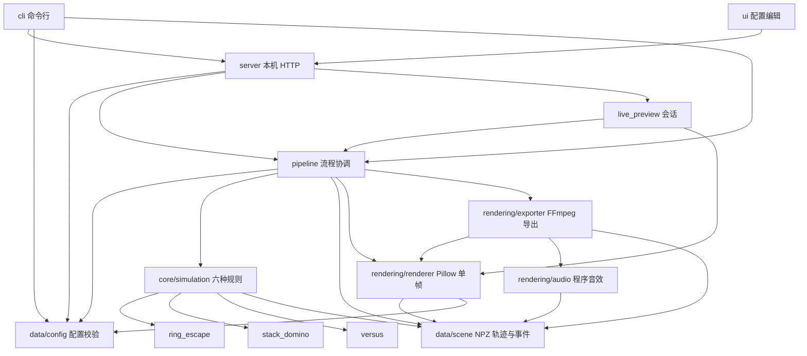

# 文件索引与职责边界

更新：2026-11-12。本地工作台采用配置、运动数据、物理模拟和渲染分层。使用方法见 [README](README.md)，机制与调参见 [方案设计](docs/方案设计.md)，配置、数据和 HTTP API 见 [开发接口](docs/contracts.md)。

## 入口、配置与资料

| 路径 | 职责 |
|---|---|
| `studio.cmd` | 使用项目内环境启动本机编辑器并打开浏览器，默认 `127.0.0.1:8765` |
| `run.cmd` / `preview.cmd` | 导出当前配置；或导出 12 秒 360×640 预览视频 |
| `watch.cmd` | 打开保留的旧原型 1080p 样片 |
| `batch.ps1` | 对指定方案按多个随机种子批量导出 |
| `render.py` | 兼容薄启动器，转交给 `src.cli.main` |
| `setup.ps1` | 在项目内安装 Python、依赖和缓存；`-Dev` 加装检查工具 |
| `scripts/check.ps1` | 测试、Ruff 检查与运行依赖审计 |
| `requirements.txt` / `requirements.lock` | 运行依赖范围与精确版本；当前 Pillow 为 13.0.0 |
| `requirements-dev.txt` / `pyproject.toml` | 可选开发工具依赖与 Ruff 配置 |
| `config/current.json` | 编辑器保存的当前完整配置，首次启动从预设创建 |
| `config/presets/` | 六个可编辑 JSON 方案：`multiply`、`escape`、`rain`、`ring_escape`、`stack_domino`、`versus` |
| `assets/fonts/` | 可选项目字体；系统字体也可供读取 |
| `docs/方案设计.md` | 六方案机制、参数含义、内容试验与后续方向 |
| `docs/contracts.md` | 配置、SceneData 和 HTTP API 合约 |
| `CHANGELOG.md` / `LESSONS.md` | 改动记录、缓存/编码/部署决策及排查提示 |
| `SKILLS_USED.md` | 开发技能与运行依赖获取方式 |
| `tests/` | 配置校验、数据模型、层次边界、轨迹复用和关键导出路径验证 |
| `tests/test_config_pipeline.py` | 配置与实际缓存复用，改变物理参数触发重算 |
| `tests/test_scene_data.py` | 基础机制、安全 NPZ、释放时间、边界、采样与导入隔离 |
| `tests/test_export.py` | 24/60fps 解码帧数、静音、元数据优先与无 Pymunk 重渲染 |
| `tests/test_physical_schemes.py` | 两个新方案的 Pymunk 事件因果、轨迹连续性和计数不变量 |
| `tests/test_versus_scheme.py` | 双通道赛判定与当前帧比分、分裂替换与代数、顿帧冻结、同色系变浅、容量账目、通道封闭性和可复现性 |
| `tests/test_versus_contacts.py` | 两侧八条边界、球球双侧分裂、高速直穿/擦碰、未就绪与持续接触、角落去重、开闸后停止的回归验证 |
| `tests/test_split_scene_data.py` | 退役原球与代数、运动/出生时钟的安全读写、旧NPZ兼容和字段校验 |
| `tests/test_live_preview.py` | 六方案预览与导出绘制像素一致、内存轨迹复用、物理改动重算、会话上限与 HTTP 校验 |
| `tests/live_preview_ui.test.mjs` | Node标准库验证播放、暂停、跳转、循环、迟帧和连续编辑竞态；`node --test tests/live_preview_ui.test.mjs` |

项目根目录的旧 `config.json` 已移除，参数以 `config/current.json` 或指定预设为准。

## 程序模块

| 路径 | 职责与依赖边界 |
|---|---|
| `src/data/config.py` | 读取、校验、保存配置，提供预设与安全字体 ID，计算运动缓存键；不模拟或绘图 |
| `src/data/scene.py` | NumPy轨迹、退役计数、代数与运动时钟模型，压缩NPZ读写、时间采样；不依赖Pymunk或Pillow |
| `src/core/simulation.py` | 调度六种运动规则，以独立采样率生成 SceneData；不加载配置文件、不调用渲染 |
| `src/core/ring_escape.py` | Pymunk 12层旋转缺口、冲量能量和逃逸/失败事件生成器 |
| `src/core/stack_domino.py` | Pymunk 机械闸门、预装球、多米诺和可破坏玻璃生成器 |
| `src/core/versus.py` | Pymunk双通道接触分裂赛：按球半径/最高速度自动细分物理子步、有效接触与新生保护、原球退役与子代新槽、去重与合并顿帧、容量判定及开闸溢出 |
| `src/rendering/renderer.py` | 读取SceneData与文字/外观配置，绘制圆环、多米诺、玻璃及双通道代际配色/出生动画；不运行物理模拟 |
| `src/rendering/audio.py` | 由 SceneData 碰撞或带类型事件合成程序音效 |
| `src/rendering/exporter.py` | 按输出 FPS 读取轨迹，绘图、编码、混音、生成联系表并执行完整解码检查 |
| `src/pipeline.py` | 协调校验、轨迹缓存、单帧预览和完整导出，组织输出目录与运行报告 |
| `src/server.py` | 本机 HTTP 服务、配置 API、连续预览帧、单帧预览、异步导出任务与安全产物访问；支持视频 Range 请求 |
| `src/live_preview.py` | 最多4个内存预览会话，复用轨迹及导出绘制器，直接返回360×640无损PNG；不编码MP4、不写预览文件 |
| `src/ui/index.html` / `src/ui/app.js` | 浏览器配置编辑、文字层控件、预览和导出状态；不计算物理、不绘制动画帧 |
| `src/ui/live-preview.js` | 连续画面播放、暂停、进度、循环、自动更新和实际帧率；单个在途请求与版本号防止旧响应覆盖 |
| `src/cli.py` | `studio`、`simulate`、`render` 命令；支持 `--config`、`--preset`、`--fps` 与 `render --scene` |
| `src/utils/paths.py` | 项目相对路径、目录创建与 outputs 路径限制 |
| `src/utils/logger.py` | 文件和控制台日志，日志写入项目 `logs/` |

箭头表示调用或读取依赖。渲染层读取数据模型，不依赖 Pymunk 或模拟实例；界面通过服务提交配置。连续预览直接请求导出绘制器生成的PNG帧，不运行第二套物理世界；高清单帧和导出接口保留。

## 数据与缓存

`scene.npz` 保存元数据、位置数组 `[采样数, 球槽数, 2]`、颜色编号、计数、圆环/挡板角度、释放状态和碰撞事件。NPZ 不含物理引擎实例或渲染对象，加载使用 `allow_pickle=False`。`frame_at(time)` 选取该时刻或之前最近的数据帧。

`versus` 额外保存 `retired`、`generations`、`motion_times`、`birth_motion_times`：原球退役后不复用槽，子球代数递增；顿帧时运动时钟与出生年龄冻结。每帧 `counts = remaining + escaped + retired`，左右比分之和为 `counts - retired`。旧NPZ缺字段时兼容，其他机制退役数缺省0。

采样率由 `simulation.sample_rate` 决定，默认 60 Hz，可设 30、60 或 120 Hz；它独立于导出 FPS。运动缓存键包含时长、完整 `simulation` 参数和新方案专属参数，保存在 `.cache/scenes/`。

- 改文字、字体、字号、位置、显隐、配色（含代际变浅强度）、输出分辨率、输出 FPS、音效开关或音量：复用运动数据，重新渲染。
- 改时长、释放时间、种子、方案、球数、半径、转速、重力、分裂规则、冷却、顿帧或数据采样率：重新模拟并建立新缓存。
- 需要直接重渲染旧数据时，使用 `render --scene` 并提供与数据匹配的原配置；文字和输出参数可单独调整。

## 本地运行产物

| 路径 | 内容 |
|---|---|
| `.runtime/python/` / `.venv/` | D 盘项目内运行时和依赖；CPU 路线无需 CUDA |
| `.cache/` | uv 下载缓存、临时文件、字节码目录和运动轨迹缓存 |
| `logs/` | 应用日志 |
| `outputs/previews/` | 按配置和时间生成的单帧 PNG |
| `outputs/studio/` | 编辑器每次完整导出的独立目录 |
| `outputs/examples/{multiply,escape,rain}/` | 三种基础 24 秒、720×1280、30fps 样片及其配置、数据、声音和报告 |
| `outputs/implemented_ring_escape/` | 方案A 19.6 秒、1080×1920、60fps 验收成片 |
| `outputs/implemented_stack_domino/` | 方案B 18 秒、720×1280、30fps 验收成片 |
| `outputs/versus_demo/` | 双通道指数赛 18 秒、720×1280、30fps 样片与完整产物 |
| `outputs/versus_split_v2/` | 新版双通道分裂：原球移除、顿帧和逐代变浅；18秒720×1280/30fps产物 |
| `outputs/versus_collision_fix/` | 碰撞触发修正版：墙、地面、顶部与球球接触分裂，统一短新生保护与接触回归报告 |
| `outputs/examples/three_schemes.png` | 三种基础方案画面对照 |
| `outputs/sample_1080p_seed42/` | 保留的旧原型 1080p 样片 |
| `outputs/` 下验证报告 | 检查与实测结果；各导出目录另有运行和解码报告 |

完整导出的核心文件为 `final.mp4`、`video_only.mp4`、`sound.wav`、`poster.png`、`contact_sheet.jpg`、`scene.npz`、`config.json`、`export_report.json` 和 `run_report.json`。脚本将项目写入位置保持在 D 盘；当前无需占用远程 4080 SUPER。
