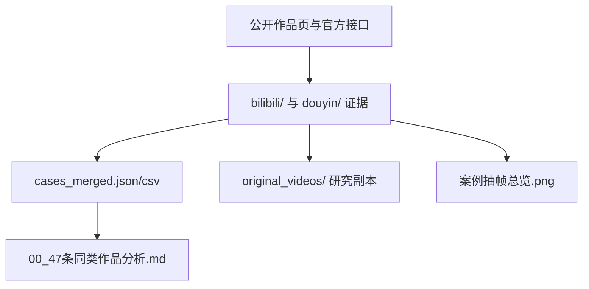

# FILE_INDEX — 同类型作品扩展与原视频归档

> 最后更新：2026-11-11

| 路径 | 作用 |
|---|---|
| `00_47条同类作品分析.md` | 47条案例的证据口径、播放/点赞、高频机制、逐条索引和本地方案建议 |
| `cases_merged.json` / `cases_merged.csv` | 47条统一目录，CSV为UTF-8 BOM |
| `build_expanded_catalog.py` | 合并明细、复制可用研究副本、生成抽帧索引 |
| `build_report.py` | 从合并目录生成主报告 |
| `案例抽帧总览.png` | 36张保存截图/抽帧的视觉索引 |
| `bilibili/` | B站官方API响应、27条新增案例、27条MP4和抽帧 |
| `douyin/` | 10条新增抖音页面证据，7条下载MP4，3条失败记录 |
| `original_videos/` | 独立原视频研究副本及 `download_manifest.json` |
| `tools/download_bilibili_public.py` | 使用公开 `view` / `playurl` API 下载并合并B站DASH流 |

