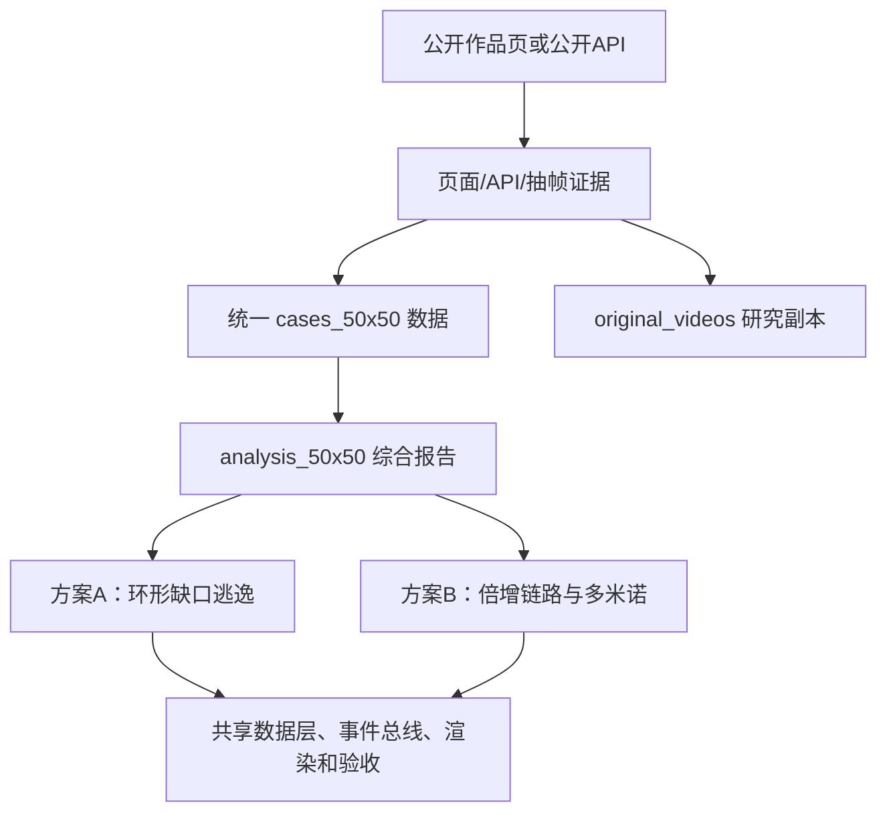

# FILE_INDEX — 50×50 同类型扩展研究与新方案

| 路径 | 用途 |
|---|---|
| `analysis_50x50.md` | B站50条 + 抖音50条逐条分析 |
| `cases_50x50.json/csv` | 指标、证据、下载状态和设计字段 |
| `download_manifest.json` | 统一下载清单与统计 |
| `original_videos/bilibili/` | B站选入50个MP4；目录共保存57个公开副本 |
| `original_videos/douyin/` | 抖音13个MP4研究副本 |
| `bilibili/` | B站接口、抽帧和下载证据 |
| `douyin/` | 抖音页面快照、截图、MP4和失败记录 |
| `analysis_framework.md` | 分析口径和机制实现词典 |
| `build_50x50_report.py` | 报告生成脚本 |
| `scheme_A_ring_escape.md` | 方案A：环形缺口逃逸、层层缩圈 |
| `../02_项目方案/03_爽感解压动画/scheme_b_stack_domino.md` | 方案B：倍增链路、破碎多米诺 |
| `two_physical_animation_schemes.md` | 两个新方案的选择、共用架构和实施顺序 |

