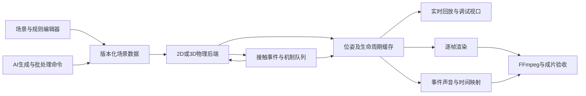

# 解压短视频引擎工程：GitHub 与现有项目选型评估

核查日期：2026-11-13。目标是本地、可扩展的2D／2.5D／3D短视频制作工程，支持物体布置、文字、物理碰撞、碰撞机制、实时调试与视频输出。本轮完成源码审计和公开资料核查，没有安装候选引擎，也没有改动现有程序。功能事实、工程判断和工期估算在下文分别说明。

**建议新建“Godot工程＋解压视频编辑插件＋机制组件库”，复用成熟引擎，保留现有项目作为二维机制、旧轨迹和导出验收基线。** 先使用Godot现成编辑器，不先fork引擎源码；需要独立中文软件时，再建设专用运行时编辑界面。Blender适合作为后续高质感渲染端。若更偏好TypeScript／Web技术，第二选择是扩展Babylon.js Editor。

这项选择意味着重新建设专用产品层，但不必自己实现渲染器和物理求解器。现有玩法、测试与成片仍有价值；为了保留全部旧源代码而把当前二维绘图工具扩成三维引擎，长期成本更高。

## 一、先统一“引擎工程”的验收范围

| 能力 | 你需要的实际行为 |
|---|---|
| 场景编辑 | 拖入球、矩形、墙、圆环、闸门、文字；选择、移动、旋转、缩放、复制、编组、吸附、撤销；保存再打开 |
| 二维／三维物理 | 刚体、静态碰撞体、传感器、重力、弹性、摩擦、碰撞层、约束、适当的CCD与求解子步 |
| 碰撞机制 | 碰到什么、在什么条件下、执行什么动作；分裂、变色、销毁、开闸、计数、声音、顿帧可组合 |
| 实时调试 | 修改场景后快速运行／重置，暂停、单步、慢放；显示碰撞体、接触点、事件和“不分裂的原因” |
| 文字与画面 | 中文字体、内容、字号、颜色、位置、动态数值；相机、安全框、材质、灯光与背景 |
| 时间与回放 | 物理运行和已记录回放分开；支持烘焙运动与事件，再拖动到任意时刻查看 |
| 视频生产 | 竖屏尺寸、时长、30／60fps、逐帧输出、声音合成、MP4、批量任务、导出检查 |
| 扩展与自动化 | 新增物体、机制和渲染风格有明确接口；AI可通过场景数据与命令批量生成和验证 |

首版假设：Windows本地、单用户、常见几何体、刚体与简单关节、30–60秒短片。复杂流体、软体切割、布料、任意网格破碎、多人协作和插件商店不计入首版。它们能作为后续专项模块，不能因为底座支持3D就视为已经具备。

**2.5D需要明确两种含义。** 二维物理＋三维外观，可以把同一条平面运动显示成带厚度、阴影、金属或玻璃材质的物体；三维物理＋正交相机／轴向约束，则有真正空间接触。两者可以共用编辑与机制描述，但不能假设碰撞结果相同。首版建议先支持前一种，再增加真正3D场景类型。

## 二、现有项目能留下什么

代码审计对象：[现有工程](../06_本地部署/relaxing-physics/README.md)。完整证据和行号见[现有项目审计](sources/current_audit.md)。

| 已有事实 | 能复用的价值 | 与新目标的差距 |
|---|---|---|
| 六种二维机制、Pymunk物理、保护期、父球替换、代数、顿帧 | 机制规范、样例、参数经验和碰撞回归 | 目前按模式编写，尚不是可挂载、可组合的机制组件 |
| SceneData与渲染分离，支持缓存重渲染 | 保留“先模拟、后渲染”和稳定ID的设计 | 坐标被限定为`[采样数,槽位数,2]`，没有通用三维变换、网格、相机与材质模型 |
| 文字内容、字体、字号、颜色和坐标可改 | 保留文字字段与版式需求 | 没有画面拖字、通用物体拖放、场景树、撤销和关键帧编辑 |
| HTTP连续预览和播放控制 | 旧作品仍可快速回看 | 准备预览时先计算整段运动，再播放PNG；不是交互式实时物理视口 |
| FFmpeg逐帧编码、音效、导出报告与完整解码 | 流程、验收方式、任务组织可迁移 | Pillow不是3D渲染器；新引擎帧获取与音画桥接仍需适配 |
| 旧配置、轨迹与参考成片 | 可作为迁移前后对照，也可有限映射到3D平面重渲染 | 换物理引擎后不能承诺旧赛果不变 |

源代码中的具体限制包括：`scene.py`校验最后一维必须为2；`versus.py`通道布局写死；`renderer.py`用Pillow并按模式分支；`live_preview.py`先调用完整轨迹生成。继续增加几个参数不能补出通用场景编辑器。

当前采样还采用最近的较早帧，不做运动插值；30Hz数据导成60fps会重复采样。因此新工程要分别设计物理频率、轨迹记录频率和输出FPS，不能只增加一个“60fps”下拉框。

结论：继续生产现有二维模板时，旧项目值得继续使用；长期统一2D／2.5D／3D编辑时，它更适合作为内容与规则基线，不宜继续承担全部底座。

## 三、GitHub项目筛选结果

以下主候选已核实仓库和官方资料；“有源码模块”不等于完成运行验收。详细授权、维护日期与证据链接见[原生路线核查](sources/native_research.md)、[Web路线核查](sources/web_research.md)及[GitHub项目清单](GitHub项目清单.csv)。

清单汇总25个GitHub仓库，分别标注官方文档／源码模块核查和仅元数据筛查，核查深度并不相同。

| 项目 | 它实际提供什么 | 授权与当前注意点 |
|---|---|---|
| [Godot](https://github.com/godotengine/godot) | 完整2D／3D引擎、场景编辑器、物理、脚本、GUI和Movie Maker | MIT；本轮API最新正式版为4.7.2-stable。EditorPlugin适合做专用插件 |
| [Godot示例工程](https://github.com/godotengine/godot-demo-projects) | 2D／3D物理、GUI和场景示例 | MIT；用于学习和基准，不是现成解压视频软件 |
| [Babylon.js Editor](https://github.com/BabylonJS/Editor) | 桌面3D场景编辑器，已有变换、撤销、材质／物理检查等模块 | Apache-2.0；README提供5.5.3。工程导出不能等同MP4导出 |
| [Babylon.js](https://github.com/BabylonJS/Babylon.js) | 3D渲染／游戏引擎、GUI、调试生态 | Apache-2.0；官方3D物理接入为Havok，真2D另接后端 |
| [Havok Web包](https://github.com/BabylonJS/havok) | 官方WASM／JS物理运行时和Babylon接入 | 包内实际LICENSE为MIT；不等于完整Havok C++源码已开放 |
| [Rapier](https://github.com/dimforge/rapier) | 2D／3D刚体、CCD、事件等物理核心 | Apache-2.0；旧`dimforge/rapier.js`已归档，采用主仓当前bindings |
| [Three.js](https://github.com/mrdoob/three.js)＋[react-three-rapier](https://github.com/pmndrs/react-three-rapier) | 自制工作台所需的3D渲染与物理封装 | MIT；仍需建设完整产品编辑器。R3F封装不等于已提供独立2D后端 |
| [Blender](https://github.com/blender/blender) | 建模、摆物、材质、文字、相机、刚体、动画与离线渲染 | GPL；Python可批处理，但标准刚体工作流不等于现成碰撞分裂事件引擎 |
| [PlayCanvas Editor](https://github.com/playcanvas/editor) | 开源Web可视编辑器前端；已有AI接入方向 | MIT；本地开发仍借助线上场景服务，不能承诺克隆即完整离线部署 |
| [Matter.js](https://github.com/liabru/matter-js)／[Phaser](https://github.com/phaserjs/phaser) | 二维物理／二维游戏框架 | MIT；适合只做2D，不能当作已经满足3D目标的完整方案 |

另筛查了Bevy、UPBGE、O3DE、GDevelop、matter-tools及若干解压动画小仓库。Bevy和O3DE会增加编辑器／工具链建设；UPBGE的完整视频闭环仍需验证；GDevelop本轮仅取得元数据，未完成所需功能和授权细节核查，不据此作首选。

`matter-tools`的本轮元数据最近推送为2022-11-10，可参考二维调试交互，但不宜直接当长期全维度编辑器底座。GitHub搜索也找到[ring-escape](https://github.com/JustLachin/ring-escape)、[engaging-animations](https://github.com/bikramadhikari001/engaging-animations)、[chaotic-system](https://github.com/QuantumZain/chaotic-system)等。它们更适合借鉴机制或视频流水线；公开说明和元数据并未证明它们拥有本次要求的通用编辑器。部分小仓库未识别出明确许可，不能因可见源码就默认可直接商用复制。

## 四、六种实施方案对比

原生编辑器插件和独立中文软件是两种交付形式，不能用同一个工期承诺。下表中的“首版”含物理、机制、文字、基本布局、调试和视频闭环；A的首版仍只做2D，已单独标出。各方案完整目标均不包含专业流体等专项能力。

| 方案 | 建设方式 | 2D／2.5D／3D覆盖 | 画面与实时编辑 | 最大缺口 | 判断 |
|---|---|---|---|---|---|
| A．扩建当前Python项目 | 保留Pymunk与导出，新增通用场景、编辑器、再接3D | 2D现成；其余需另建 | 平面效果已有；GPU视口和编辑交互需建设 | 当前场景与渲染结构专用化，完整三维改动大 | 适合继续做二维模板；不作为统一底座首选 |
| B．Godot插件工程 | 官方引擎＋场景工程＋专用编辑器Dock／组件 | 原生2D和3D；2.5D做明确适配 | 原生场景编辑与实时运行，3D材质灯光可用 | 机制组件、录制回放、视频生产面板需开发 | **整体首选，起步最均衡** |
| B2．Godot独立中文软件 | 导出Godot运行时，并自建专用编辑界面 | 同B | 可做最贴合创作的交互 | 选择、Gizmo、撤销、资源管理等不能自动继承Godot编辑器 | B成熟后的产品化阶段 |
| C．扩展Babylon.js Editor | 复用桌面编辑器、Babylon及Havok；补真2D后端 | 原生3D／2.5D；真正2D需增加 | 3D编辑基础完善，TypeScript生态方便 | 专用规则、2D适配、烘焙、文字与逐帧视频导出 | **Web／TypeScript团队优先比较** |
| D．Blender专用插件 | 复用DCC编辑、材质、动画与渲染，补机制或外接模拟 | 3D／2.5D强；真2D物理需外接 | 画面上限高；复杂效果最终渲染与实时调试是不同流程 | 自由碰撞机制和动态分裂不是标准刚体工作流的现成功能 | 画质优先，或作为第二渲染端 |
| E．自建Three／R3F＋Rapier工作台 | 使用成熟渲染／物理库，自写专用产品界面 | 能覆盖，但真正2D需专门实现适配 | 最容易完全定制网页体验 | 编辑器、资产、规则、回放和导出均需集成 | 产品形态要求很明确时考虑，首版成本较高 |

### 方案B为什么排第一

Godot已具备这次最贵的基础能力：2D与3D场景编辑、节点与资源、检查器、文字GUI、动画、物理及脚本。专用工程可以把开发精力放在“球／线／矩形预制物、碰撞规则、录制回放和视频输出”。

建议增加`addons/satisfying_video/`这类专用插件目录和独立业务组件库，使用官方扩展接口。除非确实遇到引擎层缺陷，否则不修改Godot底层渲染与物理源码；这样升级、调试和维护更容易控制。

但它不会自动提供“碰撞必定按用户理解分裂”。Godot的碰撞报告需要配置接触监控、报告数量、CCD等，自己的出生保护、Enter／Stay／Exit、球球双方、去重和容量规则仍要实现。现有项目的回归情景正好可以迁过去验证。

### 方案C什么时候更合适

如果偏好TypeScript、以后考虑浏览器访问或网页自动化，Babylon.js Editor值得实测。它比只拿Three.js画一个画布更接近现成工具。

要明确三处额外工作：第一，Havok主要是3D物理，真2D需增加Rapier 2D或其他后端；第二，Babylon与Rapier不是本轮核实到的官方开箱组合，自行对接需计工；第三，编辑器的工程导出不代表视频导出，固定时间逐帧输出与声音同步仍要做。

尽量通过扩展包和业务工程增加功能；确实要改Editor源码时，将修改集中在少量面板与扩展入口，锁定版本并跟踪上游，而不是长期全面fork编辑器。

### 方案D怎样用才划算

如果最先追求的是玻璃、金属、柔和阴影、景深和真实三维构图，Blender插件很有吸引力。但“导入一条已烘焙运动并渲染”与“自由布置物体、碰撞时实时替换并调试”是两种难度。

推荐后期由Godot或保留的Pymunk后端记录运动和事件，Blender只读取已确认的结果，负责网格、材质、灯光与最终画面。分裂和销毁通过预制体／可见性调度表现，避免Blender再跑另一份物理导致赛果变化。导入还需要传递物体ID、旋转、单位比例、出生销毁时刻和顿帧时间，不能只导出一个位置CSV就视为全部完成。

### 方案A和E各自的边界

A适合目标退回“二维模板越做越好”。如果完整新目标不变，通用场景、交互视口和3D接入的大部分工作仍要重建，迁移成本并不会因为保留Pillow而消失。

E可以获得完全贴合自己的软件界面和自动化API，但Three／Rapier提供的是基础能力，场景拾取、编组、撤销、资源管理、属性面板、规则面板、调试、历史回放和视频任务都需要建设。它是“重新实现产品层”的合理方案；从零重写物理求解器或渲染器则没有必要。

## 五、工期、费用与估算口径

统一为**1人日＝8小时工程投入**，1名熟悉所选技术的工程师，可用AI辅助；包括基础测试、文件整理与打包。来源笔记中原为6小时有效工作日的估计已换算并向上取整；Web路线按补充澄清的8小时口径计算。区间是工程判断，不是报价、承诺或已实测速度，初期仍建议预留约30%–50%不确定性。

预算以通用编辑／调试／导出能力加三类代表机制（碰撞分裂、闸门、缺口逃逸）为基础；新引擎路线并未承诺同时完整迁移六种旧模式和全部旧NPZ格式。其余模板迁移在验证后按差额安排。源码审计列出的19–36人日迁移工作包含与本表重叠的机制、编码及验收，不能将它整项再加一次。

| 方案 | 首个可用版本 | 稳定版累计投入 | 按完整目标的工程人力折算 |
|---|---:|---:|---:|
| A．当前项目扩建 | 33–55人日，**仅2D** | 100–180人日，加入完整新目标 | 约15–45万元 |
| B．Godot编辑器插件 | 15–27人日 | 30–53人日 | 约4.5–13.3万元 |
| B2．Godot独立中文软件 | 27–42人日 | 53–83人日 | 约8.0–20.8万元 |
| C．Babylon Editor，含独立2D后端 | 20–35人日 | 43–75人日 | 约6.5–18.8万元 |
| D．Blender，全机制工作台并外接必要2D能力 | 27–45人日 | 45–75人日 | 约6.8–18.8万元；事件工作流不确定性较高 |
| E．Three／R3F＋Rapier，自建并含真2D | 28–50人日 | 63–105人日 | 约9.5–26.3万元 |

费用仅用**1,500–2,500元／8小时人日**进行情景折算，展示相对建设量，不是市场报价。若由你自己与AI开发，不会必然支付这笔外包人力采购费；集成、调试与验收工作仍存在。不要把“软件免费”理解为整个工程没有投入。

两个较便宜但范围更窄的验证不能混进完整工程比较：

- 旧二维轨迹映射到三维画面的质感演示：约8–15个8小时人日，只验证2.5D重渲染。
- Blender仅做模板、缓存导入与渲染：约12–19个8小时人日，不包括完整自由碰撞机制编辑器。

开源引擎本身通常不按成片条数收费。Godot、Babylon、Three、Rapier等主路线有明确开放许可；Blender为GPL；Havok Web包本轮核实为MIT。发布工程时按实际使用组件保留相应许可，编码器、字体与素材单独记录，不能用一个引擎的许可证覆盖全部依赖。

使用Blender制作的视频通常不会因此被要求按GPL开放；分发软件、修改版或插件时是另一层授权问题。

每条短片仍有渲染机器时间、内容设计和人工筛选成本。在尚未选定场景、材质、分辨率和渲染器前，不能可靠给出“30秒成片固定几元／固定几分钟”。本轮未部署候选、未运行性能benchmark，也不承诺千球场景固定60fps。更精确的单条成本应在同一基准镜头上分别测模拟、渲染、编码耗时和人工返工。

## 六、数据、物理、机制与渲染怎样分开

建议保留现有分层原则，但换成通用场景描述，而不是继续增加`mode`分支。

最低限度的工程数据应包含：项目与规则版本、尺寸／FPS／时长、场景物理维度、单位比例、种子；物体稳定ID、父子层级、变换、几何／外观、碰撞体、刚体参数、机制组件；相机、灯光、文字与音源；以及独立的运行／烘焙结果。场景初始布局与运行后的状态分开保存。

机制第一版用“**事件→条件→动作**”即可，不必马上造完整可视化编程语言。例如：

| 事件 | 可编辑条件 | 动作 |
|---|---|---|
| 接触开始／持续 | 碰撞层、接触对象、保护结束、冲量阈值、容量 | 替换父球、生成N个子球、继承代数并变浅 |
| 进入传感器 | 物体标签、是否已触发 | 开闸、计分、播放声音 |
| 达到时间／数量 | 运行时间、当前数量、完成状态 | 改文字、停止生成、释放容器 |
| 机制执行成功 | 去重键、节奏限制 | 顿帧、音效、粒子／闪光 |

新增机制通过组件接口扩展；常用规则用参数面板配置。父球替换等写操作放在物理求解后的动作队列，记录触发依据和抑制原因，避免重复处理同一物体。稳定ID、出生／退役事件和代数继续沿用现项目的经验。

实时编辑也需要明确规则：修改初始布局、重力、碰撞机制，默认重置并重算；改文字、颜色、相机和材质，可优先重放已记录轨迹。确实允许运行中注入动作时，将动作写入时间线。拖到过去使用缓存／快照，不倒着积分物理。

## 七、视频导出、确定性与AI自动化

**同一份运动可以稳定重渲染，比“每次随机重跑都碰巧一样”更重要。** Godot官方明确说明物理不保证确定性，见[4.7物理说明](https://github.com/godotengine/godot-docs/blob/4.7/tutorials/physics/physics_introduction.rst)。Rapier JS／WASM有[有条件的跨平台确定性](https://rapier.rs/docs/user_guides/javascript/determinism/)，前提包括同版本、相同初始数据和对象增删顺序；这也不等于跨GPU画面像素一致。

因此，无论选哪个底座，都建议：固定时间步运行→记录位姿、接触及生命周期事件→记录顿帧造成的视频时间／运动时间映射→使用缓存逐帧渲染→离线合成声音→编码并完整解码验收。记录二维角度或三维四元数，处理采样插值时尊重出生和销毁边界，不能让已退役父球在插值中重新出现。

Godot已提供Movie Maker和命令行`--write-movie`／`--fixed-fps`，依据[官方录制文档](https://github.com/godotengine/godot-docs/blob/4.7/tutorials/animation/creating_movies.rst)及[4.7.2 MovieWriter](https://github.com/godotengine/godot/blob/4.7.2-stable/doc/classes/MovieWriter.xml)。建议先采用PNG序列＋WAV交给FFmpeg生成MP4；OGV有构建范围限制，AVI有4GB限制。正式录制可由第二个引擎进程承担，不应把编辑器实时录屏当作唯一导出办法。

Web路线同样应接管物理与渲染时钟，按固定时间输出帧。标题如果只盖在HTML界面上，直接抓canvas会漏字；应让文字进入实际渲染／合成路径。Blender则可用后台模式、Python和动画渲染读取已烘焙结果。

| 自动化工作 | 可实现程度与边界 |
|---|---|
| AI生成布局、文字与机制参数 | 高；输出结构化场景，先校验再加载，比逐次点击界面可靠 |
| 批量种子、批量风格与导出 | 高；提供命令入口、任务队列、状态与产物报告 |
| 检查数量、穿透、漏触发、越界文字、缺帧和音画时长 | 高，但需要先写明确验收规则与测试场景 |
| 自动筛选候选成片 | 可按增长曲线、事件密度、失败率、画面占用等指标初筛 |
| 判断是否足够解压、预测高播放 | 不能保证；仍需人工审片和平台实际内容试验 |

PlayCanvas已有[编辑器MCP项目](https://github.com/playcanvas/editor-mcp-server)，Babylon Editor源码也有MCP目录，但本轮没有验收其完整自动化契约。Godot路线也不必为了AI而先安装未经验证的第三方MCP：版本化场景数据、项目脚本和命令行就可以构成第一版自动化入口。

## 八、推荐实施顺序与停止条件

建议先用Godot做一个约5–8个8小时人日的验证，计入B的首版预算，而不是另加到总预算；这是建议工期，不是已经完成。验证只做同一组代表性场景：

1. 二维分裂球：父球移除、1→N、同代同色、顿帧；测试地面、墙、球球、高速擦碰和角落。
2. 2.5D同轨迹重渲染：同一份二维数据映射为有材质和阴影的三维外观，确认数量与时序不变。
3. 真三维矩形／球体场景：自由布置、空间碰撞、相机与灯光；单独记录三维结果。
4. 每个场景都能改中文内容、字体、字号，保存再打开，暂停单步并查看接触原因。
5. 烘焙后不重跑物理，分别导出1080×1920的30／60fps视频，核对帧数、音画、出生销毁与尾帧；对100／500／1000物体分别测编辑、模拟、渲染耗时。

若Godot在可视编辑、接触调试和逐帧输出上达标，就继续B；若无法接受原生编辑器交互，再转B2建设独立中文界面。若核心偏好明确是TypeScript／Web，则用同一基准验证C。不要因为某个引擎示例视频漂亮，就省掉机制和导出验收。

当前项目不需要删除或立刻迁完六个模式。先迁移最能暴露碰撞问题的双通道／分裂机制，保留旧片和测试作对照；验证通过后再搬其余机制。完整六模式迁移的工作项需计入所选工程计划，不与本表总工期重复相加。

本轮交付：此评估、两份GitHub路线证据、一份当前源码审计、项目清单与方案CSV。没有替用户选定后直接部署，也没有宣称候选已完成性能或浏览器交互验收。

## 九、证据入口

- [现有项目只读源码审计](sources/current_audit.md)：逐项代码路径、行号、复用边界及原始估算。
- [Godot／Blender／原生候选核查](sources/native_research.md)：许可证、当前状态、MovieWriter、物理非确定性、插件与独立软件区别。
- [Babylon／Rapier／Three／PlayCanvas核查](sources/web_research.md)：许可、真实编辑器模块、2D边界、Havok和自动化入口。
- [附加仓库元数据原始记录](sources/additional_repositories.json)：包括请求URL、抓取时间和失败请求；raw域名连接失败没有被当作功能或许可证明。
- [方案对比CSV](方案对比.csv)、[GitHub项目清单CSV](GitHub项目清单.csv)。

仓库活跃时间只用于辅助判断维护状态，不等于正式发布和稳定性证明。成本为统一口径后的估算，效果与性能仍需用上面的同一基准短片验证。
