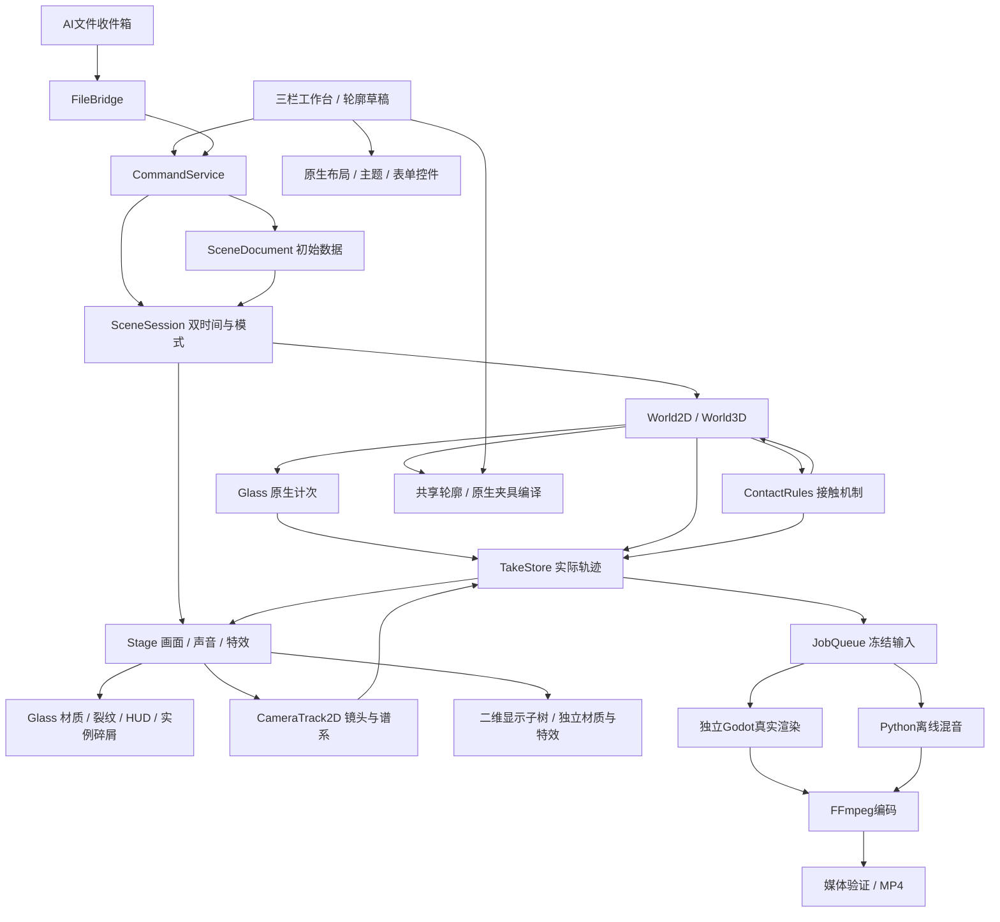

# Godot 解压视频工作台文件索引

更新日期：2026-11-16。默认入口为新工作台，旧验证原型单独保留。`.gd.uid`是Godot生成的脚本标识，随对应脚本保存，此处不逐项重复。

## 入口、配置与文档

| 文件 | 职责 |
|---|---|
| `project.godot` / `workbench.tscn` | Godot工程与默认工作台场景 |
| `production.tscn` | 独立生产进程的干净画面入口 |
| `一键启动.cmd` | 双击打开工作台；保留重复启动/错误提示，支持空格路径 |
| `preview.cmd` / `workbench.cmd` | 启动新工作台；preview支持场景选择与显式旧版入口 |
| `editor.cmd` | 便携环境下启动原生Godot编辑器，F5运行工作台 |
| `render.cmd` | 保留的旧版无声渲染入口 |
| `config/workbench_glass.json` / `glass.cmd` | 8扇区二维玻璃演示与便携入口 |
| `config/workbench_neon.json` / `neon.cmd` | 128球青蓝/粉色荧光场景与便携入口 |
| `config/workbench_long.json` | 720×20000纵向长世界、斜坡、U形与子球谱系跟随演示；`preview.cmd -Scene long`可启动 |
| `docs/长场景与轮廓编辑使用验收.md` / `docs/design/native-editor-20261116/` | 原生长世界/轮廓/局部表现操作、数据字段、实际界面截图、验收与限制 |
| `docs/二维荧光使用与验收.md` | 二维荧光、高光、性能与样片证据 |
| `docs/玻璃使用与验收.md` | 使用方法、实例化边界、专项和样片证据 |
| `config/workbench_2d.json` | 可运行v2二维碰撞分裂场景 |
| `config/workbench_3d.json` | 可运行v2真实三维刚体＋正交相机场景 |
| `config/workbench_perspective.json` | 可运行v2透视三维场景 |
| `config/demo_*.json` | 旧验证原型场景，只供旧入口使用 |
| `README.md` / `CHANGELOG.md` | 项目入口说明、实际能力与改动记录 |
| `AGENTS.md` / `.env.example` | 其它AI接手约束、配置覆盖模板 |
| `LESSONS.md` | 主开发线、Take与便携包的决策、踩坑预防和项目约定 |
| `config/runtime-lock.json` | Windows x64工具的版本、URL、SHA-256、校验来源和许可 |
| `docs/.gdignore` | 禁止把研究CSV自动导入为翻译；显式FileAccess读取不变 |
| `docs/AI交接.md` / `docs/需求与对话决策.md` | 当前目标、真实架构边界、已定语义、历史需求与下一步 |
| `docs/视频研究交接.md` / `docs/reference_media_inventory.json` / `docs/reference_media_index.csv` | 视频内容、研究证据与相对路径/大小/SHA媒体盘点 |
| `docs/迁移与打包说明.md` / `docs/迁移验收.md` | 离线恢复、配置、完整性、Git历史及异盘实际验证 |
| `docs/standards/ENGINEERING_STANDARD_ENHANCED_v2.1.md` | 用户提供的通用工程标准原文 |
| `docs/third_party/` | Godot、FFmpeg许可和附带声明正文 |
| `docs/工作台使用说明.md` | 三栏界面、六个设置入口、录制/回放/生产、AI协议、代码调试与边界 |
| `docs/长场景与属性面板方案_20261116.md` | 历史Git核对和接入设计；顶部链接最新实施状态，音频分路/多轨背景音等仍待实现 |
| `docs/形状编辑环境与多列属性方案_20261116.md` | 多列属性、已有场景直接修改与新建草图双入口、轮廓原位更新、模拟接入方案，L形/U形物理可行性与未集成边界 |
| `docs/design/inspector-20261116/` | 九类多列属性及形状绘制/布置原型、逐页PNG、交互验证；各源文件职责见目录README |
| `docs/design/inspector-20261116/native-shape-check.gd` / `native-shape-validation.json` | 独立工程运行的凸分解/原生接触检查与9项实测结果；不启动工作台或控制桥 |
| `docs/破坏机制与参考渲染选项.md` | 三条本地参考抽帧证据、破坏/耐久/碎片/渲染选项及已实现与待新增边界；设计文档 |
| `docs/工作台扩展方案.md` | 保留的整体目标方案；顶部说明已实现子集 |
| `docs/对象机制特效与时间轴规范.md` | 保留的数据/机制/时间目标规范；非完整已实现API清单 |
| `docs/examples/scene_v2.example.json` | `proposal_only`设计示例；日常运行使用workbench配置 |
| `docs/验证报告.md` / `docs/依赖来源.md` | 原型实测记录、便携运行约束与依赖来源 |
| `docs/工作台验收报告.md` | 新工作台的实际分模块、生产和样片验收记录 |
| `.runtime/` / `.godot/` / `scratch/` | 工程盘运行依赖、导入缓存、临时验证数据；不纳入源码 |
| `outputs/` | 控制命令、Take、生产任务、样片、验证证据；不纳入源码 |
| `outputs/samples/manifest.json` | 稳定样片路径与原始生产任务来源 |
| `outputs/one_click_validation.json` | 一键入口的独立副本真实启动、重复实例、GPU画面与缺工具检查记录 |

## 新工作台源码

| 文件 | 职责 |
|---|---|
| `src/document/scene_document.gd` | v2场景校验、稳定ID、字段路径更新、simulation_hash、对象初始规格 |
| `src/document/shape_geometry.gd` | 无节点的简单多边形校验、轮廓/AABB/最近边界，供物理/绘制/拾取复用 |
| `src/document/extended_validation.gd` | 可选长世界/镜头/独立材质/特效与物理材质校验，兼容旧v2 |
| `src/document/object_style.gd` | 全局/独立物体材质及特效解析，后代沿root_id读取初始物体表现 |
| `src/document/scene_workspace.gd` | 六种新建模板、保存基线、文件身份、示例保护与原子保存 |
| `src/commands/command_service.gd` | AI/面板统一修订号命令、原子批量应用、校验、回执与50步初始数据撤销/重做 |
| `src/commands/file_bridge.gd` | JSON收件箱、已处理文件、结果回执、原子发布场景/运行状态 |
| `src/runtime/scene_session.gd` | 编辑/模拟/录制/回放状态、双时间、实际物理启停、音效消费 |
| `src/physics/world_2d.gd` | 原生二维刚体与传感器、拾取/布置、接触、状态采样/恢复 |
| `src/physics/world_3d.gd` | 原生三维刚体与传感器、三维拾取/平面布置、状态采样/恢复 |
| `src/physics/shape_2d.gd` | 同一几何编译圆/矩形/厚线/扇区/凹多边形原生碰撞夹具；多片保持同一刚体 |
| `src/physics/primitive_3d.gd` | 三维原语、材质、变换及几何辅助 |
| `src/physics/birth_space_2d.gd` | 出生几何的保守网格筛选，精确窄相仍由World2D判断 |
| `src/physics/native_contacts_2d.gd` | 原生接触信号的双向集合与退役清理 |
| `src/physics/contact_anchor.gd` | 从明确的形状几何估算表现锚点；不冒充引擎真实接触点 |
| `src/mechanisms/contact_rules.gd` | 接触episode、保护期重试、子球继续分裂开关、批次分裂/移除、容量与空间拒绝原因 |
| `src/presentation/stage.gd` | 共享的干净Stage、世界/特效/文字组合、三维投影与输出缩放 |
| `src/presentation/camera_track_2d.gd` | 固定快照驱动二维纵向镜头、死区/平滑/只向下/谱系选择，实时与任意Take寻帧共用 |
| `src/presentation/body_visuals_2d.gd` | 独立二维显示子树、逐物体荧光分组；相机移动不改变物理节点 |
| `src/presentation/effect_batch.gd` / `effect_circle.gdshader` | 圆形特效的实例批量与像素抗锯齿 |
| `src/presentation/neon_2d.gd` / `neon_ball.gdshader` / `neon_wall.gdshader` | 两个实例批次的球面高光、边框亮线与解析光晕 |
| `src/presentation/effects.gd` | 按事件/年龄恢复的屏幕粒子、圆环、闪光、Take拖尾 |
| `src/presentation/audio.gd` | 合成短音、本地PCM WAV、试听、限流和预览声部 |
| `src/takes/take_store.gd` | 有界完整JSON轨迹、生命周期定义、校验、二分寻帧与过期依据 |
| `src/production/job_queue.gd` | 单个活动任务、冻结场景/Take/WAV、子进程、状态与协作取消 |
| `src/production/renderer.gd` | 无物理解算的Take恢复、干净画面逐帧PNG导出 |
| `src/ui/workbench.gd` | 主控制器；串联命令/会话/预览/AI桥/生产，维护选择与拖动 |
| `src/ui/workbench_ui.gd` | 原生界面协调、六入口/上下文导航、草稿同步、状态、时间轴与预览坐标转换 |
| `src/ui/workbench_layout.gd` / `workbench_theme.gd` | 三栏工作空间与原生控件主题、顶部文件/底部录制、可见状态及键盘焦点 |
| `PRODUCT.md` / `DESIGN.md` / `.impeccable/design.json` | 已确认产品约束、实现后的视觉规则和设计侧车；不是运行时场景数据 |
| `docs/design/workbench-redesign-20261116/` | `brief.md`设置取舍；`验收.md`验证与复核；PNG/GPU截图、联系表与`capture_manifest.json`图片来源/哈希；JSON/日志为专项和完整回归证据 |
| `docs/design/workbench-usability-20261116/` | 运行/暂停、物体ID可见、按名称选跟随目标的补充验收、原生GPU截图、专项报告和图片来源/哈希 |
| `docs/design/camera-follow-fix-20261116/` | 当前用户场景边界钳制根因、修正副本、修复前后GPU证据、七项回归及主窗口跟随实测 |
| `config/design-skill-lock.json` / `SKILLS_USED.md` | Taste/Impeccable来源、版本、许可、复现安装；仅用于AI开发辅助 |
| `src/ui/scene_panel.gd` | 长世界范围、跟随参数、标准边界同步，复用统一草稿/命令事务 |
| `src/ui/world_minimap.gd` | 编辑器世界缩略图、真实物体/画幅概览、编辑导航逆变换，不进入成片 |
| `src/ui/shape_canvas.gd` / `shape_editor.gd` | 原生局部轮廓绘制/改顶点/网格吸附、已有ID应用/副本/取消/修订冲突保护 |
| `src/ui/object_visual_panel.gd` | 独立材质/特效面板、各自应用/草稿/锁定，保留运动与全局设置 |
| `src/ui/scene_bar.gd` | 新建/打开/保存/另存为入口、文件窗口与未保存切换提示 |
| `docs/场景管理验收.md` | 场景管理范围、操作和实测证据 |
| `scenes/` | 用户保存场景的默认目录，不纳入源码Git |
| `src/ui/form_helpers.gd` | 表单控件、88px数值框/多列换行、选项和字段读取辅助 |
| `src/ui/pending_edits.gd` | 待应用表单组、草稿恢复、多物体修改快照与统一提交收集 |
| `src/ui/object_panel.gd` | 初始对象列表、布置/物理/外观属性、锁定与增删复制 |
| `src/ui/component_panels.gd` | 机制、声音、屏幕特效参数面板 |
| `src/ui/production_panels.gd` | 渲染/相机/文字、Take回放与视频生产面板 |

## 玻璃模块

| 文件 | 职责 |
|---|---|
| `src/glass/geometry.gd` | 统一轮廓、原生凸碰撞片及最近边界估计 |
| `src/glass/damage.gd` | 原生接触计次、防重复、暂停保护和一次延迟破裂 |
| `src/glass/surface.gd` / `glass.gdshader` | 共享玻璃材质、附着裂纹、面内剩余数字 |
| `src/glass/view.gd` | 实时/回放共享的面、中心HUD与碎屑组合 |
| `src/glass/shards.gd` / `shard.gdshader` | 确定性三角视觉碎屑的MultiMesh实例化 |
| `src/glass/recording.gd` | 损伤姿态序列化、回放输入校验 |
| `tools/validate_glass.gd` | 真实撞击、反向寻帧、UI事务及非法状态回归 |
| `tools/validate_neon.gd` | 荧光参数校验、真实面板应用、物理不重置、保存与Take恢复 |

## 启动与生产工具

| 文件 | 职责 |
|---|---|
| `tools/common.ps1` | 项目盘路径和临时环境、Godot位置、错误日志检查 |
| `tools/runtime_environment.ps1` | 环境变量＞.env＞项目默认的工具路径、当前盘临时/缓存设置 |
| `tools/setup.ps1` | 用锁定SHA缓存/URL恢复Godot、独立Python/Pillow、FFmpeg和可选MinGit |
| `tools/build_handoff.py` | 选择必要资料/源码/运行工具、导出Git历史、冻结初始场景、生成ZIP与内容清单和校验 |
| `tools/inventory_reference_media.py` | 按作品ID盘点媒体副本、SHA与历史指标/证据，相对研究根路径 |
| `tools/preview.ps1` | 默认新工作台、编辑器与显式Legacy启动 |
| `tools/one_click.ps1` | 复用便携预览入口，用项目互斥锁和进程检查避免重复工作台 |
| `tools/record_take.gd` | 命令行调用实际物理解算并录制Take |
| `tools/produce_take.gd` | 校验已有Take、提交同一生产模块、等待真实结束状态 |
| `tools/render_take.ps1` | 独立原生渲染、离线混音、H.264/AAC编码、完整验证和协作取消 |
| `tools/mix_take.py` | Take事件到48kHz立体声PCM，合成短音或本地PCM WAV |
| `tools/inspect_job.py` | 完整解码、尺寸/FPS/帧数/时长、音轨/音画对齐、冻结资源检查 |
| `tools/render.ps1` / `tools/inspect_media.py` | 旧版无声样片导出、媒体和联系表检查 |

## 验证工具

2026-11-14新增：`tools/validate_performance_paths.gd`（几何差分/接触集合/PCM/特效），`tools/validate_fast_ccd.gd`（独立高速碰撞），`tools/benchmark_workbench.gd`（真实GPU窗口的预览/录制计时，须在副本执行）；报告见`docs/性能验收_20261114.md`。

本次新增：`tools/validate_split_controls.gd`覆盖真实机制面板、输入2/4/100、暂停后运行和Delete；`docs/工程标准落实.md`记录标准适用范围，`docs/standards/ENGINEERING_STANDARD_ENHANCED_v2.2.md`为本次用户标准原文。

| 文件 | 检查范围 |
|---|---|
| `tools/validate_workbench.ps1` | 新工作台统一验收入口；可加Legacy与实际WAV生产，检查新报告并汇总套件状态 |
| `tools/validate_portable_runtime.ps1` | 独立Python、锁定工具SHA、.env优先级、空格路径及工程盘写入检查 |
| `tools/validate_handoff.py` | 小夹具重打包、路径越界拒绝、内容选择、ZIP与篡改检测；不代替真实异盘运行 |
| `tools/validate_worlds.gd` | 新二维/三维适配器、原生碰撞和机制行为 |
| `tools/validate_split_inheritance.gd` | 默认48体拒绝诊断、二维/三维多代分裂开关、其它机制保留及布尔字段校验 |
| `tools/validate_commands.gd` | 编辑事务、修订号冲突、幂等与撤销/重做 |
| `tools/validate_session.gd` | 物理暂停/单步、双时间、录制与回放 |
| `tools/validate_workbench.gd` | 原生工作台与统一命令集成 |
| `tools/validate_ui.gd` | 面板命令、原值保持、相机/声音/碰撞过滤、锁定、预览坐标与错误展示 |
| `tools/validate_effect_switches.gd` | 特效独立开关、碰撞喷溅上限、即时面板控制、保存与回退确定性 |
| `tools/validate_speed_apply.gd` | 二维/三维原生速度门槛、多物体/跨页原子应用、撤销与失败保护 |
| `tools/diagnose_motion.gd` / `tools/validate_motion.gd` | 渲染/模拟推进对照时间线、连续运动默认值与可选顿帧回归 |
| `tools/benchmark_split_capacity.gd` / `docs/分裂同屏容量实测_20261114.md` | 独立副本真实GPU分裂容量/持续出生帧耗时测量；记录严格60帧尚未达标和屏内数量限制 |
| `docs/碰撞停顿排查与修复.md` | FPS正常但运动冻结的根因、当前场景开/关对照与修复证据 |
| `docs/性能与批量应用验收.md` | 最低速度/统一应用用法、回放修复与原始GPU性能证据 |
| `tools/validate_scene_workspace.gd` | 六类型真实世界保存重开、中文路径、未保存提示、失败保护与布局保存 |
| `tools/validate_scene_editing.gd` | 原生轮廓新建/同ID修改/撤销/冲突、长世界选取拖动、局部表现/88px/持久化 |
| `tools/validate_editor_layout.gd` | 三栏/尺寸/焦点/状态、草稿、参数过滤、继承、录制/导出/快捷键；可选真实GPU截图 |
| `tools/validate_camera_follow.gd` | 实际短世界/根球后代下落、镜头受限复现、UI修正保持物理状态、真实回放；可选用户快照和GPU截图 |
| `tools/validate_camera_track.gd` | 镜头死区/平滑/边界/只向下/谱系/乱序寻帧与非法配置 |
| `tools/validate_polygon_styles.gd` | 实际L/U原生碰撞、出生空间、后代特效/颜色/时钟、3D静态/PBR材质 |
| `tools/validate_long_world.gd` | 真实长场景录制/分裂/跟随及实时/回放镜头对照，生成供生产的Take |
| `outputs/scene_editing_20261116/` / `outputs/samples/long_world_follow.mp4` | 本轮专项/完整回归/媒体证据、冻结输入、Take及实际样片，不纳入源码Git |
| `tools/validate_media.gd` | 程序化表现、预览声音与资源格式 |
| `tools/validate_mixer.py` | 离线混音、声部/限流与事件时间对齐 |
| `tools/validate_capacity.gd` | 活动物体/固定物体边界、实际世界采样、Take保存/加载和拒绝溢出 |
| `tools/validate_wav_job.gd` | 实际入队后删除原WAV，验证冻结副本及整段生产音频 |
| `tools/validate.ps1` / `tools/validate_2d.gd` / `tools/validate_host.gd` | 旧原型物理、顿帧、JSON自动重载迁移基线 |

## 保留的原型

| 文件 | 职责 |
|---|---|
| `main.tscn` / `scripts/main.gd` | 旧配置、预览按键、文件监听、自动报告与无声逐帧导出 |
| `scripts/probe_2d.gd` | 旧二维刚体/分裂原型与既有夹具 |
| `scripts/probe_3d.gd` | 旧三维球体/方块、灯光和相机原型 |

## 模块关系

| 模块边界 | 对外数据/入口 | 修改影响 |
|---|---|---|
| document / commands | v2 JSON、修订号命令与回执 | 初始场景、校验、编辑历史；物理改动使Take过期 |
| runtime / physics / mechanisms | 会话模式、接触事件、动作、姿态 | 实际物理和玩法；不负责混音与视频编码 |
| presentation | 场景表现字段、事件、显式双时间 | 文字/材质/声音/屏幕特效，可复用物理Take |
| takes | 场景快照、生命周期、事件、姿态JSON | 实际回放与视频采样，不恢复求解器内部缓存 |
| production / tools | 冻结快照、规格、阶段状态、验证报告 | 独立输出与取消，不改活动预览 |
| ui / file_bridge | 面板操作或JSON命令文件 | 调用同一领域命令，不各自修改运行物理 |
