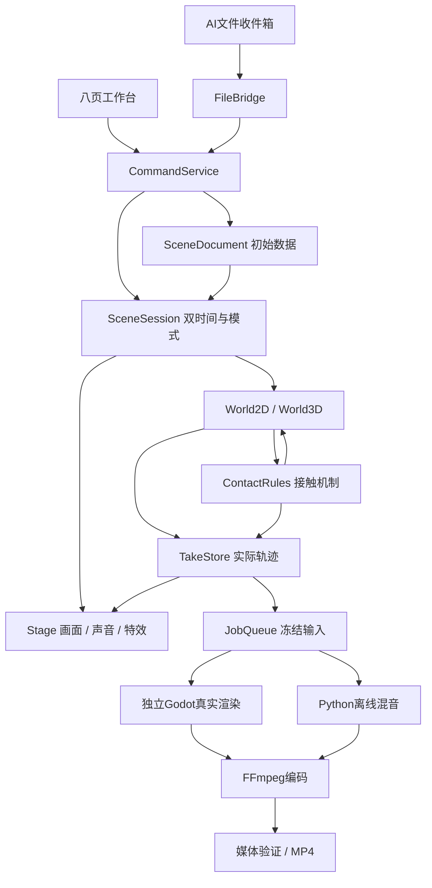

# Godot 解压视频工作台文件索引

更新日期：2026-11-13。默认入口为新工作台，旧验证原型单独保留。`.gd.uid`是Godot生成的脚本标识，随对应脚本保存，此处不逐项重复。

## 入口、配置与文档

| 文件 | 职责 |
|---|---|
| `project.godot` / `workbench.tscn` | Godot工程与默认工作台场景 |
| `production.tscn` | 独立生产进程的干净画面入口 |
| `preview.cmd` / `workbench.cmd` | 启动新工作台；preview支持场景选择与显式旧版入口 |
| `editor.cmd` | 便携环境下启动原生Godot编辑器，F5运行工作台 |
| `render.cmd` | 保留的旧版无声渲染入口 |
| `config/workbench_2d.json` | 可运行v2二维碰撞分裂场景 |
| `config/workbench_3d.json` | 可运行v2真实三维刚体＋正交相机场景 |
| `config/workbench_perspective.json` | 可运行v2透视三维场景 |
| `config/demo_*.json` | 旧验证原型场景，只供旧入口使用 |
| `README.md` / `CHANGELOG.md` | 项目入口说明、实际能力与改动记录 |
| `docs/工作台使用说明.md` | 八个面板、录制/回放/生产、AI协议、代码调试与边界 |
| `docs/破坏机制与参考渲染选项.md` | 三条本地参考抽帧证据、破坏/耐久/碎片/渲染选项及已实现与待新增边界；设计文档 |
| `docs/工作台扩展方案.md` | 保留的整体目标方案；顶部说明已实现子集 |
| `docs/对象机制特效与时间轴规范.md` | 保留的数据/机制/时间目标规范；非完整已实现API清单 |
| `docs/examples/scene_v2.example.json` | `proposal_only`设计示例；日常运行使用workbench配置 |
| `docs/验证报告.md` / `docs/依赖来源.md` | 原型实测记录、便携运行约束与依赖来源 |
| `docs/工作台验收报告.md` | 新工作台的实际分模块、生产和样片验收记录 |
| `.runtime/` / `.godot/` / `scratch/` | 工程盘运行依赖、导入缓存、临时验证数据；不纳入源码 |
| `outputs/` | 控制命令、Take、生产任务、样片、验证证据；不纳入源码 |
| `outputs/samples/manifest.json` | 稳定样片路径与原始生产任务来源 |

## 新工作台源码

| 文件 | 职责 |
|---|---|
| `src/document/scene_document.gd` | v2场景校验、稳定ID、字段路径更新、simulation_hash、对象初始规格 |
| `src/commands/command_service.gd` | AI/面板统一修订号命令、校验、回执、50步初始数据撤销/重做 |
| `src/commands/file_bridge.gd` | JSON收件箱、已处理文件、结果回执、原子发布场景/运行状态 |
| `src/runtime/scene_session.gd` | 编辑/模拟/录制/回放状态、双时间、实际物理启停、音效消费 |
| `src/physics/world_2d.gd` | 原生二维刚体与传感器、拾取/布置、接触、状态采样/恢复 |
| `src/physics/world_3d.gd` | 原生三维刚体与传感器、三维拾取/平面布置、状态采样/恢复 |
| `src/physics/primitive_3d.gd` | 三维原语、材质、变换及几何辅助 |
| `src/physics/contact_anchor.gd` | 从明确的形状几何估算表现锚点；不冒充引擎真实接触点 |
| `src/mechanisms/contact_rules.gd` | 接触episode、保护期重试、子球继续分裂开关、批次分裂/移除、容量与空间拒绝原因 |
| `src/presentation/stage.gd` | 共享的干净Stage、世界/特效/文字组合、三维投影与输出缩放 |
| `src/presentation/effects.gd` | 按事件/年龄恢复的屏幕粒子、圆环、闪光、Take拖尾 |
| `src/presentation/audio.gd` | 合成短音、本地PCM WAV、试听、限流和预览声部 |
| `src/takes/take_store.gd` | 有界完整JSON轨迹、生命周期定义、校验、二分寻帧与过期依据 |
| `src/production/job_queue.gd` | 单个活动任务、冻结场景/Take/WAV、子进程、状态与协作取消 |
| `src/production/renderer.gd` | 无物理解算的Take恢复、干净画面逐帧PNG导出 |
| `src/ui/workbench.gd` | 主控制器；串联命令/会话/预览/AI桥/生产，维护选择与拖动 |
| `src/ui/workbench_ui.gd` | 原生Control界面、八标签页、工具栏、时间轴、预览坐标转换 |
| `src/ui/form_helpers.gd` | 表单控件、选项和字段读取辅助 |
| `src/ui/object_panel.gd` | 初始对象列表、布置/物理/外观属性、锁定与增删复制 |
| `src/ui/component_panels.gd` | 机制、声音、屏幕特效参数面板 |
| `src/ui/production_panels.gd` | 渲染/相机/文字、Take回放与视频生产面板 |

## 启动与生产工具

| 文件 | 职责 |
|---|---|
| `tools/common.ps1` | 项目盘路径和临时环境、Godot位置、错误日志检查 |
| `tools/setup.ps1` | 恢复便携Godot与FFmpeg、导入工程 |
| `tools/preview.ps1` | 默认新工作台、编辑器与显式Legacy启动 |
| `tools/record_take.gd` | 命令行调用实际物理解算并录制Take |
| `tools/produce_take.gd` | 校验已有Take、提交同一生产模块、等待真实结束状态 |
| `tools/render_take.ps1` | 独立原生渲染、离线混音、H.264/AAC编码、完整验证和协作取消 |
| `tools/mix_take.py` | Take事件到48kHz立体声PCM，合成短音或本地PCM WAV |
| `tools/inspect_job.py` | 完整解码、尺寸/FPS/帧数/时长、音轨/音画对齐、冻结资源检查 |
| `tools/render.ps1` / `tools/inspect_media.py` | 旧版无声样片导出、媒体和联系表检查 |

## 验证工具

| 文件 | 检查范围 |
|---|---|
| `tools/validate_workbench.ps1` | 新工作台统一验收入口；可加Legacy与实际WAV生产，检查新报告并汇总套件状态 |
| `tools/validate_worlds.gd` | 新二维/三维适配器、原生碰撞和机制行为 |
| `tools/validate_split_inheritance.gd` | 默认48体拒绝诊断、二维/三维多代分裂开关、其它机制保留及布尔字段校验 |
| `tools/validate_commands.gd` | 编辑事务、修订号冲突、幂等与撤销/重做 |
| `tools/validate_session.gd` | 物理暂停/单步、双时间、录制与回放 |
| `tools/validate_workbench.gd` | 原生工作台与统一命令集成 |
| `tools/validate_ui.gd` | 面板命令、原值保持、相机/声音/碰撞过滤、锁定、预览坐标与错误展示 |
| `tools/validate_media.gd` | 程序化表现、预览声音与资源格式 |
| `tools/validate_mixer.py` | 离线混音、声部/限流与事件时间对齐 |
| `tools/validate_capacity.gd` | 活动物体/固定物体边界、实际世界采样、Take保存/加载和拒绝溢出 |
| `tools/validate_wav_job.gd` | 实际入队后删除原WAV，验证冻结副本及整段生产音频 |
| `tools/validate.ps1` / `tools/validate_2d.gd` / `tools/validate_host.gd` | 旧原型物理、顿帧、JSON自动重载迁移基线 |

## 保留的原型

| 文件 | 职责 |
|---|---|
| `main.tscn` / `scripts/main.gd` | 旧配置、预览按键、文件监听、自动报告与无声逐帧导出 |
| `scripts/probe_2d.gd` | 旧二维刚体/分裂原型与既有夹具 |
| `scripts/probe_3d.gd` | 旧三维球体/方块、灯光和相机原型 |

## 模块关系

| 模块边界 | 对外数据/入口 | 修改影响 |
|---|---|---|
| document / commands | v2 JSON、修订号命令与回执 | 初始场景、校验、编辑历史；物理改动使Take过期 |
| runtime / physics / mechanisms | 会话模式、接触事件、动作、姿态 | 实际物理和玩法；不负责混音与视频编码 |
| presentation | 场景表现字段、事件、显式双时间 | 文字/材质/声音/屏幕特效，可复用物理Take |
| takes | 场景快照、生命周期、事件、姿态JSON | 实际回放与视频采样，不恢复求解器内部缓存 |
| production / tools | 冻结快照、规格、阶段状态、验证报告 | 独立输出与取消，不改活动预览 |
| ui / file_bridge | 面板操作或JSON命令文件 | 调用同一领域命令，不各自修改运行物理 |
