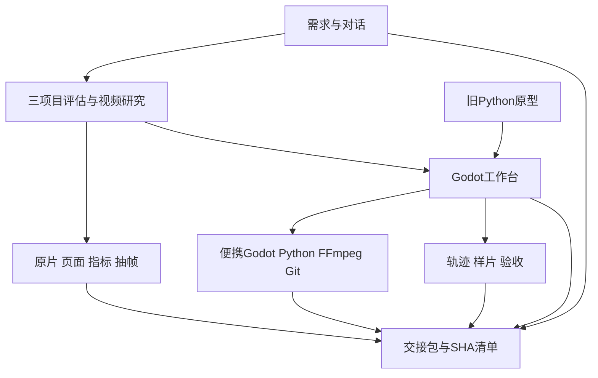

# 研究任务与迁移包索引

更新：2026-11-13。此索引覆盖任务根；Godot和历史Python代码分别有自己的FILE_INDEX。

| 路径 | 职责 |
|---|---|
| `START_HERE.md` / `AGENTS.md` | 接手阅读顺序、运行入口、目标和约束 |
| `START_WORKBENCH.cmd` / `OPEN_EDITOR.cmd` / `VERIFY_PACKAGE.cmd` | 双击启动、源码编辑、包完整性检查 |
| `tools/start_project.ps1` | 从当前目录定位部署工程，不依赖旧盘符 |
| `README.md` / `CHANGELOG.md` / `SKILLS_USED.md` | 研究入口、交接改动、工具依赖说明 |
| `00_项目评估总报告.md` / `.docx` | 原三个项目的内容、商业与技术评估 |
| `01_参考视频/` | 三条原始链接的实际原图/视频及证据 |
| `02_项目方案/` / `03_成本测算/` / `04_实施与自动化/` | 分项目方案、公式成本工作簿和实施检查表 |
| `05_证据与来源/` | 仓库/价格/政策的历史查询资料 |
| `06_本地部署/godot-video-lab/` | 当前工作台、源码、文档、便携运行工具和验收证据 |
| `06_本地部署/relaxing-physics/` | 历史Python原型源码、锁定依赖和主要成片；迁移包不带旧venv |
| `06_本地部署/src/` | 保留的历史展示层代码片段，非当前入口 |
| `07_同类视频调研_20261111/` / `08_同类作品扩展_20261111/` | 阶段性同类案例与视频副本 |
| `09_50x50扩展/` | 主50＋50分析、页面证据、107条主原片和机制设计 |
| `10_GitHub实现路线与成本对比_20261112.md` / `11_引擎选型评估_20261113/` | 实现方式边界、GitHub路线、引擎选择和成本比较 |
| `docs/conversation_readback/` | 当前任务的对话文字/JSON导出及其范围说明 |
| `tools/download_references.py` / `inspect_media.py` | 历史下载尝试和媒体抽帧工具；不是当前运行依赖 |
| `tools/research_sources.py` / `build_deliverables.py` | 历史来源查询与报告/成本表生成 |
| `MANIFEST.json` | 仅在交接包生成：相对路径、大小、SHA-256、源码版本和场景来源 |
| `version_history/` | 仅在交接包生成：Git bundle和必要的工作区patch |

| 模块 | 责任边界 |
|---|---|
| 研究与证据 | 保存来源与观察，明确历史状态，不替代实现验收 |
| 当前引擎 | 场景/命令/物理/机制/表现/轨迹/生产，具体耦合见工程交接 |
| 迁移与版本 | 完整目录、独立依赖、内容校验和历史恢复，不复制活跃队列 |
