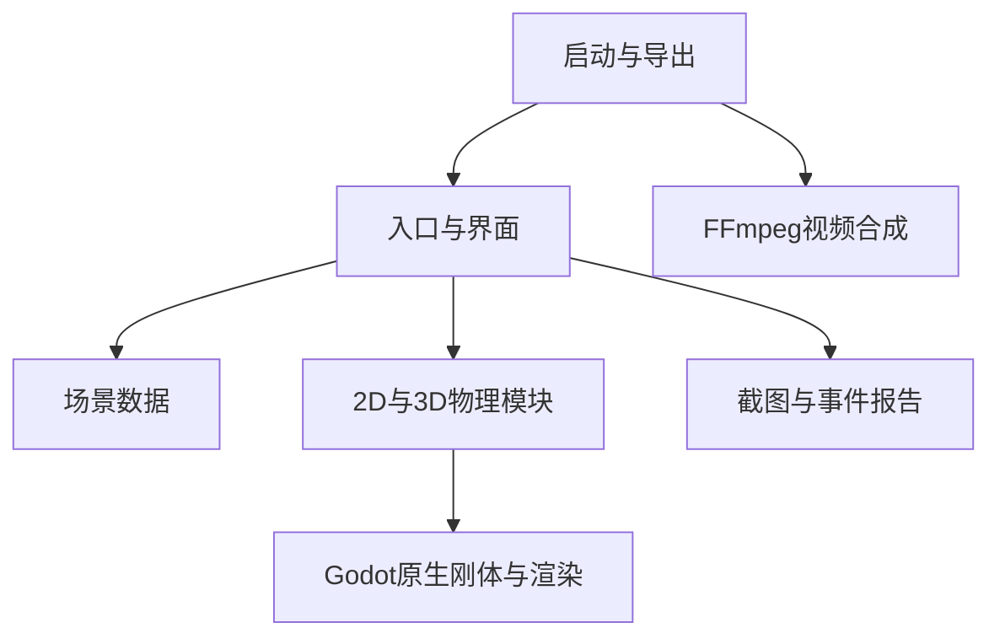

# Godot 视频验证工程文件索引

更新日期：2026-11-13。当前为最小验证工程。

| 文件 | 职责 |
|---|---|
| project.godot / main.tscn | 原生 Godot 工程和入口场景 |
| scripts/main.gd | 配置加载、文字界面、预览控制、顿帧、自动报告 |
| scripts/probe_2d.gd | 真实二维刚体、碰撞分裂和事件账目 |
| scripts/probe_3d.gd | 真实三维球体/方块、灯光和相机 |
| config/*.json | 与渲染代码分离的场景数据 |
| tools/common.ps1 / setup.ps1 | 项目盘环境、依赖恢复与错误日志检查 |
| tools/preview.ps1 / render.ps1 | 便携预览、编辑器启动、MP4导出 |
| tools/validate.ps1 / validate_2d.gd / validate_host.gd | 接触夹具、分裂账目、顿帧和自动重载验收 |
| tools/inspect_media.py | 完整视频解码、媒体参数与物理画面顿帧检查、联系表 |
| preview.cmd / editor.cmd / render.cmd | 用户启动入口 |
| docs/ | 验证记录、依赖来源和边界 |
| .runtime/ | D盘便携 Godot 和临时数据，不纳入源码 |
| outputs/ | PNG、视频、事件报告，不纳入源码 |

| 模块 | 对外接口 | 改动影响 |
|---|---|---|
| config | JSON | 对应场景和文字 |
| probes | setup / get_report / event_logged | 物理、统计与画面 |
| main | 命令行参数、预览按键 | 加载、预览与导出 |
| tools | PowerShell启动参数 | 运行环境与产物 |
