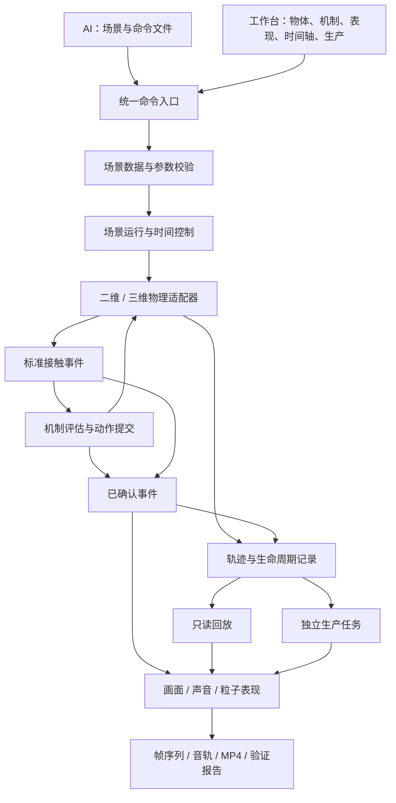

# Godot 解压视频工作台扩展方案

日期：2026-11-13。状态：设计方案，尚未实现下述新增模块。

## 1. 推荐路线与目标

沿用已经部署的 Godot 4.7.2，增建面向短视频的工作台，逐步拆出当前物理原型。Godot继续负责渲染、刚体求解、输入和原生界面；工程负责物体与机制数据、AI控制、可解释调试、轨迹记录和视频生产。不修改Godot引擎源码，也不先引入完整ECS框架。

最终工作流：**用户描述想法 → AI修改场景/组件 → 实时预览与调试 → 录制一条轨迹 → 回放挑选 → 从同一轨迹生产视频**。

AI是主要操作者；面板让用户看结果、调关键参数、定位问题。用户不必先学Godot编辑器才能制作一条视频。

工作台采用可独立运行的Godot应用：Control界面＋独立SubViewport画面。面板不只做成EditorPlugin，以免离开Godot编辑器就无法使用；Godot编辑器保留给AI调试工程与高级场景制作。

### 当前已有基础

| 已有 | 改造方式 |
|---|---|
| `probe_2d.gd`：真实碰撞、分裂、原球退役、同色变浅 | 保留已验证行为，逐步拆为二维世界、分裂机制、二维表现 |
| `probe_3d.gd`：球、长方体、容器、斜坡 | 保留刚体与接触验证，把固定布局、材质和相机改为数据 |
| `main.gd`：文字、暂停、顿帧、配置重载 | 收缩为入口，把时间、界面和场景运行分开 |
| `render.ps1`：PNG转无声MP4 | 保留快速导出，增加基于轨迹的正式生产任务与离线混音 |
| 六项二维夹具、顿帧/重载验证、四组媒体检查 | 作为迁移基线；不能因架构改造丢失已修复的碰撞行为 |

## 2. 整体架构



| 模块 | 核心职责 | 不承担的工作 |
|---|---|---|
| SceneDocument | 初始布局、对象、组件、资源与版本 | 不保存运行中的Godot节点引用 |
| CommandService | AI与面板共用的校验、修改、撤销和结果回执 | 不让两套入口各自改节点 |
| SceneSession / Clock | 编辑、模拟、暂停、录制、回放状态与时间 | 不把界面时间当成成片时间 |
| World2D / World3D | 原生刚体、接触采集、物理动作、状态采样 | 不播放声音或编排视频 |
| MechanismRunner | 根据事件评估规则，集中提交增删/变更 | 不在接触回调中直接销毁刚体 |
| Visual / Audio / Effect | 渲染、混音、程序化粒子与表现预设 | 不改变碰撞结果，不决定分裂 |
| TakeRecorder / ReplayPlayer | 记录实际状态、事件、生命期，按时间恢复 | 不用重新跑物理假装轨迹回放 |
| ProductionQueue | 输入快照、独立渲染、混音、编码和媒体检查 | 不读取正在被用户编辑的活动场景 |

数据使用JSON保存；Godot Resource可承载运行时类型、材质和音频引用。持久场景数据只有一个权威来源，避免JSON与`.tres`各有一份互相覆盖的状态。细节见《对象机制特效与时间轴规范》。

## 3. 物体类与物体布置

“对象是什么”和“对象会做什么”分开。球不再为“会分裂、会发声、会发光”建立不同子类，而是挂不同组件/规则。

| 对象类别 | 首批支持 | 布置与属性 |
|---|---|---|
| 动态刚体 | 二维圆、矩形；三维球、长方体 | 位置、旋转、尺寸、质量、初速度、角速度、颜色、物理材质 |
| 静态边界 | 地面、墙、斜坡、有厚度的线段 | 端点/尺寸、角度、碰撞层、标签、是否可见 |
| 触发区域 | 二维矩形/圆形；三维盒/球区域 | 进入、停留、离开事件；只感知或附加机制 |
| 表现对象 | 文字、背景、相机、灯光、特效发射点 | 字体字号、位置、层级、相机参数和灯光参数 |
| 后续扩展 | 圆环、多边形、胶囊、路径、转轴等 | 各类型声明维度、编辑字段与碰撞体能力后再接入 |

线条不能只有一根绘制线：直线障碍必须定义厚度和碰撞形状；曲线/圆环需要分段或组合碰撞体。绘制几何与碰撞几何默认来自同一份尺寸，调试面板可叠加对照。

布置工具包括：点选、框选、移动、旋转、尺寸编辑、复制、删除、网格吸附、间距排列、分组与锁定。二维提供平面拖放；三维首版提供选中高亮、移动/旋转手柄、地面吸附和数值输入，复杂建模留给Godot/Blender。

预览缩放与留黑边后，鼠标位置先转换到逻辑画面，再做二维点选/三维射线拾取；不能直接把窗口像素当世界坐标。三维默认Y向上，地面布置在XZ平面，其他工作平面明确切换。

编辑模式下拖动修改初始布局；模拟时直接拖改刚体坐标默认禁用。需要模拟中拖拽时，另做显式的拖拽力工具并记录干预事件。保存默认保存初始布局；“把当前帧设为初始布局”是单独命令。

## 4. 机制组件与碰撞调试

| 组件/机制 | 功能 | 关键参数 |
|---|---|---|
| PhysicsBody | 原生运动、摩擦、弹性与碰撞过滤 | 质量、重力、阻尼、恢复系数、碰撞层与掩码、CCD |
| SplitOnContact | 碰撞后父球退役，创建指定总数的子球 | 目标标签、子球总数、新生保护、上限、尺寸/速度策略 |
| RecolorOnEvent | 按代数或事件改变颜色 | 同色系、逐代变浅、颜色曲线 |
| HitStopOnEvent | 在成片时间中插入顿帧 | 时长、同批合并、受影响时间域 |
| Despawn / Transform | 进入指定区域后移除或替换形状 | 区域/标签、替换预设、触发次数 |
| Force / Motor（后续） | 风、吸引、推动、旋转等有源运动 | 力场、作用范围、最大速度、启停时段 |

反弹默认交给物理材质，不再每次接触额外加一次“反弹力”。若玩法需要加速，单独使用有源的增速规则并显示速度上限。

碰撞事件分为进入、持续、离开。持续接触用于新生保护到期后的重新评估，但不能让同一次接触每个物理步都重新播放音效、喷粒子。球球双方依据同一批接触快照评估；墙角多接触可以保留多个来源，但每个父球只提交一次分裂。

面板必须能展示完整因果链，例如：

```text
球A → 地面：引擎已报告接触
规则：碰撞分裂
判定：未执行
原因：新生保护剩余0.018秒
处理：仍接触时到期重试；若已离开则不补发
```

同样显示标签不匹配、冲击不足、数量上限、动作冲突与出生空间不足。这样“没有分裂”不会再次成为只能猜测的问题。首版容量策略建议整次跳过并显示原因，不暗中把1→2改成1→1。

## 5. 渲染、音效与粒子组件

| 分类 | 首版内容 | 调试方式 |
|---|---|---|
| 画面与文字 | 背景、物体颜色、描边、层级、字体、字号、文本、安全区域 | 实时预览、选中包围框、文字溢出提示 |
| 三维质感 | 基础材质、粗糙度、金属度、灯光、阴影、正交/透视相机 | 材质预设、光照切换、相机视角与目标点 |
| 音效 | 木质、金属、玻璃、橡胶、电子短音预设；本地WAV导入 | 单次试听、撞击强度映射、音量/音高、声部表、静音/独听 |
| 粒子 | 撞击火花/碎屑、分裂爆点、扩散圆环、淡出闪光 | 单次触发、慢放、数量/寿命/速度/颜色/大小曲线、重播 |
| 轨迹表现 | 残影、拖尾、轨迹线 | 历史长度、采样间距、宽度、透明度、开关对照 |
| 镜头表现 | 小幅震动、冲击闪光 | 幅度、持续时间、触发事件、时间域 |

音效和特效绑定标准事件及对象标签，可保存为预设。同一套碰撞可选择“玻璃短音＋亮点”或“木质敲击＋碎屑”，无需修改物理。

原始碰撞事件保持完整；音效端合并同一对物体的重复通知，限制并发与最短间隔，防止密集碰撞变成噪声。首版可使用程序化短音与自有WAV，不依赖在线生成服务。

粒子首版优先采用能用“事件种子＋粒子年龄”直接重建的程序化短效，而非仅调用原生粒子发射器。这样向前/向后拖动时间轴都能恢复正确状态。GPU粒子作为后续高密度模式，需验证所选渲染后端的能力，并对准确寻帧单独做烘焙或预热方案。

默认：物体、拖尾和碎屑随模拟时间冻结；音效与撞击闪光按成片时间推进。每个特效可改时间域，界面明确展示。随机数按事件独立取种子，关闭粒子不能改变球的轨迹。

渲染先保持当前Compatibility后端。高级辉光、景深等若依赖其他后端，应显示能力状态并另做实测，不给出看似可调但没有效果的参数。

## 6. 工作台与调试面板

布局建议：左侧场景树，中间预览，右侧属性，底部时间轴/事件/任务。首版用固定区域和标签页，避免先花大量工作做复杂停靠系统。成片画面放独立Stage Viewport，面板不进入视频。

| 面板 | 需要具备的操作与信息 |
|---|---|
| 场景与物体 | 对象列表、搜索、分组、增删复制、锁定、坐标/尺寸/速度、排列与吸附 |
| 机制 | 为对象/标签添加机制，启停、排序、筛选条件、参数、冲突提示 |
| 渲染 | 画幅、背景、相机、光照、材质、文字字体与字号、调试叠加 |
| 音效 | 预设、事件绑定、试听、强度映射、音量音高、声部与削波提示 |
| 特效 | 粒子/闪光/拖尾预设、触发方式、寿命数量、随机种子、时间域 |
| 回放 | 录制/停止、轨迹加载、拖动寻帧、逐成片帧、区间与循环播放 |
| 调试 | 碰撞体、接触点/法线、速度箭头、ID/代数、规则接受/拒绝原因、事件筛选 |
| 性能 | 预览FPS、物理耗时、活动刚体/接触/粒子/音频声部数、记录大小 |
| 视频生产 | 尺寸、FPS、时长/区间、质量、音量、任务队列、进度、取消、输出与验证 |

主场景状态明确分为编辑、模拟、手动暂停、录制、回放；后台生产属于独立任务状态，可与编辑或模拟并行。工具栏同时提供“单物理步”和“单成片帧”：前者推进一次固定求解，后者移动一个视频采样间隔，两者不能混为同一个按钮。

参数修改的反馈分三类：表现参数可立即预览并复用轨迹；初始布局、尺寸、质量和机制规则需要重新模拟，旧轨迹显示过期；回放中的物体位置只读。撤销重做作用于编辑命令，不声称能撤销物理已经走过的历史。

## 7. 轨迹回放与视频生产

一条Take保存实际位置/旋转、对象出生退役、父子关系、机制与表现事件，以及模拟时间到成片时间的映射。它是正式回放和导出的共同依据。

同一个随机种子不等于同一条轨迹。正式生产应读取Take，关闭物理与机制再次触发；按成片采样时刻重建物体和特效，再离线混音。渲染30fps和60fps使用同一条Take，不各自重新跑一次物理。

```text
校验场景与轨迹 → 冻结输入快照 → 渲染帧序列
→ 根据事件时间混音WAV → 编码MP4 → 完整解码与音画校验
```

每个生产任务使用独立目录，保存场景快照、轨迹引用、资源摘要、渲染参数、日志、音轨、成片与检查报告。首版单任务串行，生产使用独立Godot进程，当前预览仍可继续修改；修改不影响已经开始的任务。

输出首选H.264＋AAC MP4，预设720×1280与1080×1920、30/60fps；默认音轨48kHz。固定轨迹画幅可改变，物理场地尺寸不随视频分辨率改变。导出仍需真实渲染后端，不能使用本机headless Dummy当成成片渲染。

## 8. AI控制与拓展方式

AI与面板都经CommandService：加载/保存场景、增删改对象、配置组件、模拟启停/单步、轨迹录制/寻帧、提交生产任务。每条命令有ID、场景版本、结构化结果和错误字段；过期版本不会直接覆盖用户刚改的内容。

首版使用本地命令文件队列与结果回执即可，不先部署网络服务。新增玩法代码由AI在工程内添加规则脚本、登记参数并补夹具；日常内容生产只改场景数据和预设。

新增一种物体：登记形状与维度能力 → 工厂创建显示/碰撞体 → 暴露属性字段 → 增加保存加载/碰撞验证。新增机制：声明触发、条件、动作与参数 → 注册规则 → 自动进入机制列表 → 增加行为夹具。新增特效：实现事件消费与指定年龄求值 → 注册预设 → 做往返寻帧验证。

## 9. 实施顺序与验收

| 阶段 | 交付 | 关键验收 |
|---|---|---|
| A：场景与组件底座 | 数据迁移、稳定ID、二维/三维适配器、物体树与属性、保存加载/撤销 | 原有夹具全通过；重开布局一致；几何与碰撞体对齐；AI与面板修改结果一致 |
| B：机制与表现调试 | 分裂组件、规则因果日志、基础渲染、碰撞音效、三类短效 | 球球双方可处理、墙角只分裂一次；关闭表现不改变物理；音效不翻倍；容量限制可见 |
| C：Take与时间轴 | 双时间记录、生命期、录制/寻帧/区间回放、粒子年龄重建 | 往返寻帧不新增物体/再次分裂；顿帧姿态不变；不同输出FPS复用同一轨迹 |
| D：生产闭环 | 带音频MP4、独立任务、取消、媒体检查、预设变体 | 实际帧数/时长正确；无调试UI；音轨非全静音；测试点击音与画面事件对齐误差≤一帧；生产不改预览 |

实现难度主要在C：轨迹生命期、顿帧双时间和粒子寻帧；D需处理离线音画同步与任务隔离。面板字段本身不是主要难点，应避免先把界面做满而没有可靠的底层数据。

首版覆盖刚体与几何原语、短效粒子、简单声音混合、只读回放、单任务生产。软体、流体、布料、复杂骨骼动画、大规模GPU粒子精确寻帧、多轨剪辑与多人协作暂不纳入。

所有源码和运行文件继续放当前D盘独立工程；以后启用远程4080电脑时，按用户既有约束选其非C/D盘路径，再整体迁移。沿用便携启动器，不能因新模块后台运行而重新写入C盘项目缓存。

详细数据与接口：`对象机制特效与时间轴规范.md`。示例：`examples/scene_v2.example.json`。示例是新架构草案，当前验证版尚不能直接加载。
