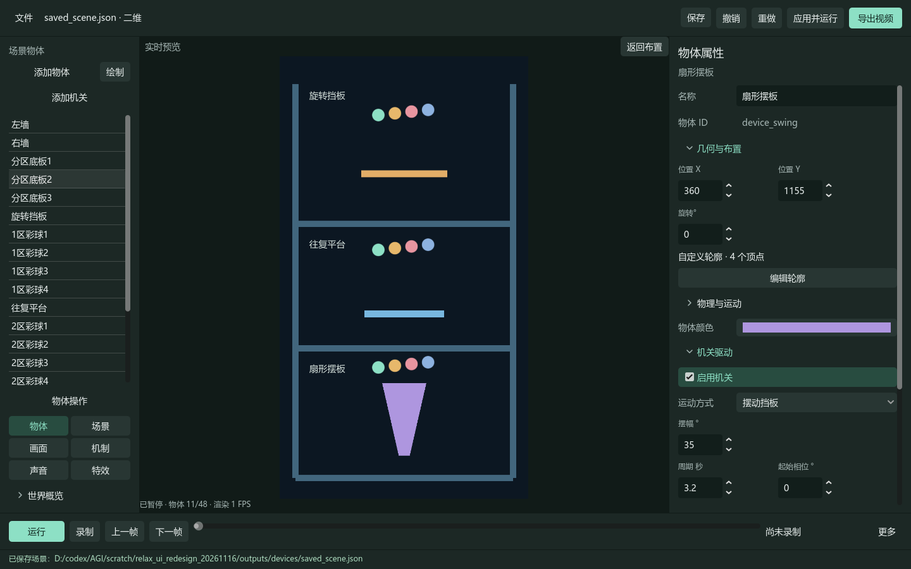
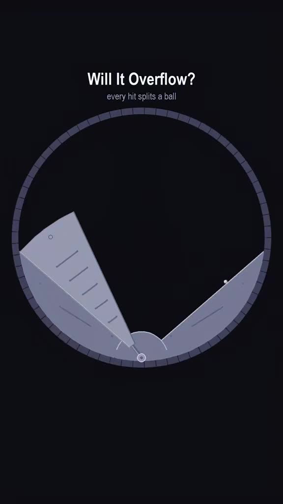

# 二维机关：设置、参考与实现

2026-11-16。首批接入旋转挡板、往复平台、摆动挡板；使用真实二维碰撞，支持已有场景、自绘轮廓、独立材质、录制和视频生产。

## 使用入口

1. 重新打开工作台，使新代码生效。当前旧窗口及其场景没有被本轮测试替换，关闭前请保存需要保留的场景与轨迹。
2. 左侧 **添加机关**，选择旋转挡板、往复平台或摆动挡板。选中后，在右侧 **机关驱动** 调参。
3. 在 **几何与布置** 调整位置、尺寸和初始角度，或用 **编辑轮廓** 画扇叶、挡板、U 形等轮廓。碰撞体与显示使用同一形状。
4. 点击右侧 **应用物体**，再运行；也可用顶部 **应用并运行**，统一提交各页草稿。物理修改从初始布局重新开始，旧轨迹会过期，可撤销。
5. **文件 → 新建场景 → 机关演示** 包含三类机关和分区彩球。命令行也可用 `preview.cmd -Scene devices`，请勿对同一工程重复开工作台。
6. 录制后拖动时间轴回放，再使用原来的 **导出视频**。场景保存的是初始布置，Take 保存实际运动。

已有普通二维物体也有折叠的 **机关驱动** 区域。勾选启用会把该物体的草稿模式改为固定物体，并取消该物体自身的分裂组件；提交前仍可取消或调整。被机关撞到的球继续使用原有分裂规则。玻璃破坏组件与电机暂不能装在同一个物体，三维场景也暂不支持电机。



## 哪些参数可以设置

| 设置 | 含义 |
|---|---|
| 启用机关 | 关闭后回到初始布置中的固定碰撞体；需要应用后生效 |
| 运动方式 | 连续旋转、正弦往复移动、正弦往复摆动；只显示当前类型所需参数 |
| 转速 °/秒 | −360～360，正数顺时针，负数逆时针，0 停转 |
| 总行程 px | 往复运动两端之间距离，0～2000；不是单边振幅 |
| 方向 ° | 世界坐标中的移动方向，0 向右，90 向下，−90 向上 |
| 摆幅 ° | 相对摆动中线的单边幅度，0～170，完整角度跨度为两倍摆幅 |
| 周期 秒 | 往返一整次的时长，1～120；越短越快 |
| 起始相位 ° | 改变开始时的方向及在运动周期中的位置；适合错开多个机关 |
| 支点 X / Y | 旋转或摆动的物体局部支点，±2000；[0,0] 是轮廓原点，选中时薄荷绿圆圈标出支点 |
| 位置 / 初始角度 | 始终表示 t=0 的物体姿态；相位变化不会让启动瞬间跳位置 |
| 颜色、物理材质、独立材质和特效 | 沿用已有物体属性与独立表现系统，未另造一套全局设置 |

常规数值框沿用 88px 多列。输入仍是草稿，选中其它物体后再回来可保留；点击应用时提交。

相位的具体语义：若波形为 `w(t)=sin(2πt/T+φ)−sin(φ)`，移动位移为 `方向×行程/2×w(t)`，摆动角增量为 `摆幅×w(t)`。因此初始位置不是固定的行程中点：相位为 0 时从中间开始，相位为 90° 时从一端开始。摆动中线相应为 `初始角度−摆幅×sin(φ)`。同一个支点在世界中保持不动，物体中心会随偏心旋转移动。

## 参考画面与取舍

参考视频 [7705831565992955145](https://www.douyin.com/video/7705831565992955145)，本地研究记录对应 AOV 视觉科学《Blender｜这个动画太有创意还解压！》。本轮复核了既有 0～44 秒关键帧拼图，并从本地原视频重新抽取 4 秒画面，证据保存在下图。画面能证明底部支点、左右变化的扇形挡板及彩球运动；不能仅据画面证明作者实际用了哪款软件。



本轮复用其“挡板改变接下来碰撞方向”的机关设计：扇形摆板示范轮廓从底端延伸，上下两区分别示范连续转杆和往复平台。后两者是本工程的通用扩展，未冒充这条视频里都有。没有照搬末段容器爆开或大规模增殖。

这三类都是**外部电机驱动**：电机持续输入能量、规定运动轨迹，球的反弹、摩擦、相互碰撞交给 Godot。不是靠重力自由摆动的摆锤，也不是声称封闭系统能量守恒。固定场景中的障碍不会自动阻停电机，应避免轨迹穿墙或无空间挤压。高速、薄障碍、大行程组合不保证永不穿透；可减速、加厚或提高物理频率，录制后检查轨迹。

## 数据、机制、渲染与 AI 控制

| 模块 | 职责 |
|---|---|
| `src/document/device_spec.gd` | 无节点的数据默认值、类型和范围校验 |
| `src/physics/device_motion_2d.gd` | 固定物理步驱动 AnimatableBody2D，计算偏心支点与运动姿态 |
| `src/physics/world_2d.gd` | 原生碰撞体创建与驱动接入，接触继续进入现有 ContactRules |
| `src/ui/device_panel.gd` | 当前物体的紧凑参数组，复用 PendingEdits 和 CommandService |
| `body_visuals_2d.gd` / Take / 视频生产 | 绘制原生求解后的姿态、保存与恢复机关运动，不在渲染端重新求解 |

AI 与 UI 仍共用修订号、校验、撤销和锁定。新增机关示例：

```json
{"op":"object.add","args":{"kind":"swing"}}
```

从 `outputs/control/scene.current.json` 读取新对象 ID 后修改：

```json
{
  "op": "object.update",
  "base_revision": 2,
  "args": {
    "id": "读取实际ID后替换",
    "changes": {
      "motion.amplitude_degrees": 40,
      "motion.period_seconds": 3.2,
      "motion.pivot": [0, 90]
    }
  }
}
```

其中 `base_revision` 也必须替换为实际修订号。把已有固定物体改成机关时，一次提交 `physics.mode="static"` 和完整 `motion`，不要绕过 CommandService 直接移动节点。`motion.enabled` 缺省为 false，旧场景不加组件就保持旧行为。机关进入物理 hash，物理参数变化需要重录；外观修改仍可复用轨迹。

暂停、单步和分裂顿帧均使用现有模拟时钟。回放/成片使用 Take 中保存的机关姿态，回放世界没有机关碰撞体，不会重复触发分裂。最低碰撞速度继续沿用现有相对线速度采样，尚未增加真实接触点切向速度、法线和冲量测量。

## 验收证据

专项 `tools/validate_devices.gd` 在隔离副本中使用真实工作台、原生物理和 GPU，最终 30 项检查通过：

- 三类机关都产生球接触，往复平台真实托起球，偏心支点保持不动。
- 碰撞触发原有分裂，分裂顿帧中机关姿态冻结；暂停和单物理步正确。
- 三种添加入口、草稿切换保留、88px 输入、统一应用并运行、撤销、保存重开、Take 保存/加载/往返回放正确。
- 周期为零、非法支点、动态模式启用电机、三维添加被拒绝；机关变化令旧 Take 过期。

完整 `validate_workbench.ps1 -Legacy -WavJob` 共 27 阶段全部通过，用时 278.505 秒，报告在 [full_suite.json](design/devices-20261116/full_suite.json)。此后补充已有对象转机关与非法容器检查，最终 30 项 GPU 专项通过，见 [devices_validation.json](design/devices-20261116/devices_validation.json)。所有测试在隔离副本运行，没有覆盖用户工作台的控制目录。

本轮真实输出 [8 秒演示视频](../outputs/samples/devices_demo.mp4)：720×1280、30fps、240 帧、H.264＋AAC。15 项媒体检查通过，包括完整解码、240 个不同帧、无黑帧、可解码且非静音音轨、音画起点对齐，见 [media_validation.json](design/devices-20261116/media_validation.json)。Take 在 `outputs/samples/devices_demo.take.json`，SHA-256 与相对路径保存在 [sample_manifest.json](design/devices-20261116/sample_manifest.json)。视频和 Take 属本地运行产物，不进入源码 Git；完整工程迁移应保留 `outputs/samples/`，源码克隆可从模板重新录制和导出。

当前范围：二维电机机关。尚未加入被动铰链、弹簧、绳索、任意曲线路径、接触触发开门、三维电机和真实破碎机关。现有三维功能保持原能力。
