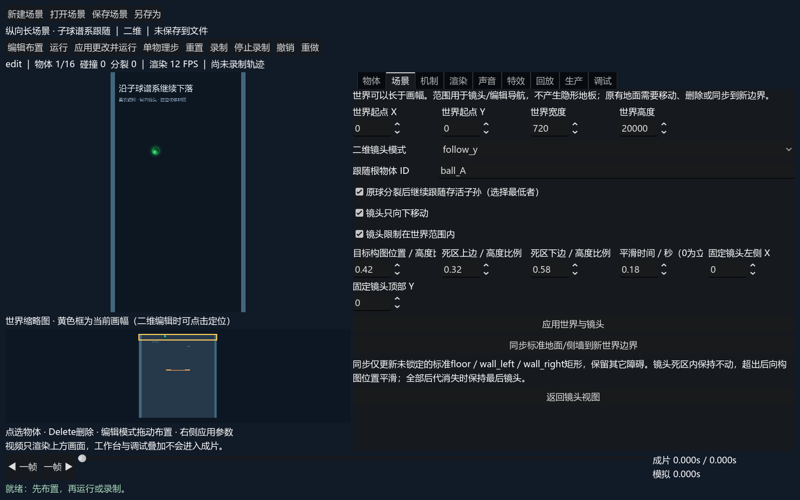
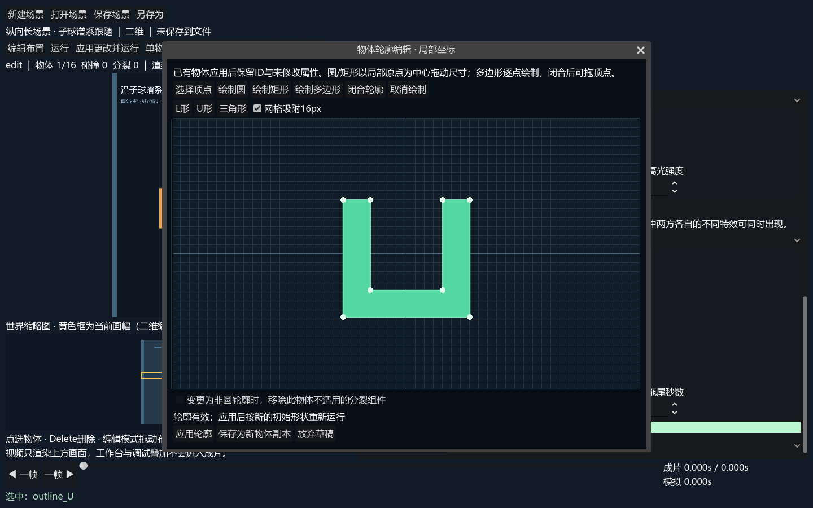
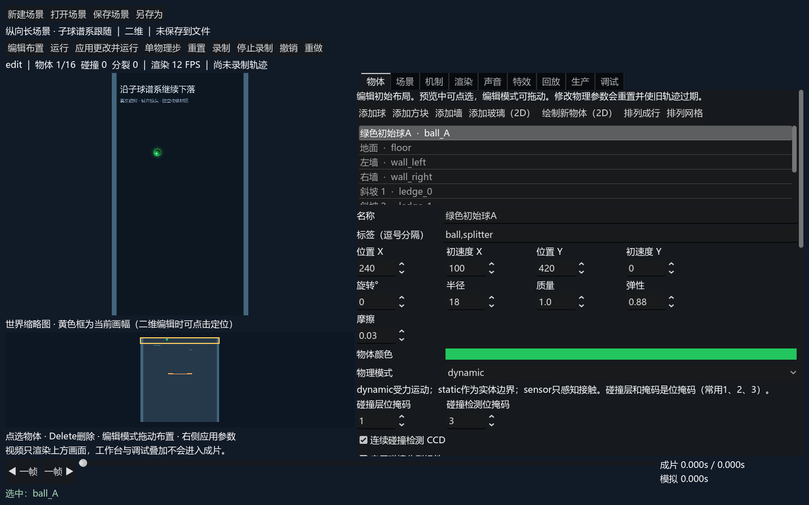
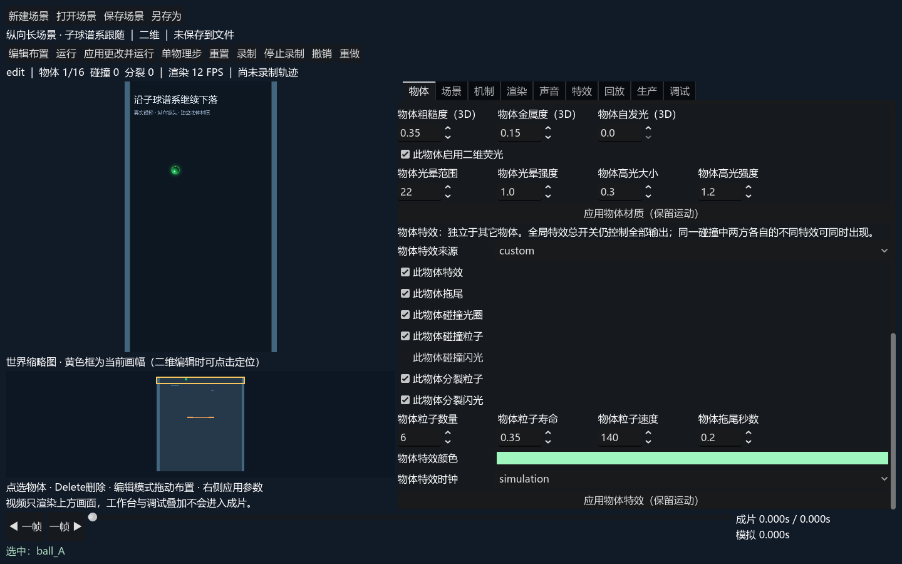

# 长场景、轮廓编辑与独立物体表现

日期：2026-11-16。本文说明已接入原生 Godot 工作台的功能；旧 HTML 属性原型仅保留作设计历史。启动入口仍为工程根目录的 `一键启动.cmd`，本轮未增加运行依赖。

## 1. 先打开演示

顶部“新建场景”选择“纵向长场景”，保留示例物体后创建；或“打开场景”选择 `config/workbench_long.json`。也可在工程目录运行 `preview.cmd -Scene long`。示例世界为 720×20000，包含会分裂的球、长侧墙、底部地面、斜坡和可编辑的 U 形物体。

点击“运行”观察向下跟随；点击“录制”记录运动，停止后拖时间轴，最后在“生产”页导出视频。修改示例后使用“另存为”保存自己的场景。

## 2. 世界、镜头和缩略图

右侧新增“场景”页，与“物体”页并列。

| 设置 | 行为 |
|---|---|
| 世界起点、宽度、高度 | 用于镜头边界和世界缩略图。可大于画幅；宽高允许 1～100000 逻辑像素，不表示任何长度、密度都已有性能保证 |
| `fixed` / `follow_y` | 固定镜头 / 纵向跟随；二维画幅仍为 720×1280，纵向跟随不自动水平追踪 |
| 跟随根物体 ID | 填初始对象 ID，例如 `ball_A`；留空时使用第一个初始动态物体 |
| 分裂后继续跟随 | 原球存在时跟随原球；退役后在该根谱系的存活后代中选世界 Y 最大者，同高度按 ID 稳定选择；可继续到孙代及更深后代 |
| 关闭分裂后继续跟随 | 原球消失后保持最后镜头；不会改跟无关球 |
| 死区上边、下边 | 目标处于这两个画幅高度比例之间时镜头保持；越界后向“目标构图位置”移动 |
| 平滑时间 | 秒。越大追赶越慢；0 为立即定位。跟随使用模拟时间，分裂顿帧不会继续消耗平滑时间 |
| 只向下移动 | 球反弹向上时镜头不倒退。关闭后可向上跟随 |
| 限制在世界范围内 | 约束镜头，未添加物理碰撞边界；关闭后可跟随到世界范围之外 |
| 固定镜头左侧、顶部 | 镜头起始左上角的世界坐标；跟随时也从这里开始 |

**扩大世界不会自动移走原地面。** 如果原地面还在 Y≈1280，小球仍会被它挡住。可以在物体页移动/删除，或使用“同步标准地面/侧墙到新世界边界”。同步只更新未锁定的静态矩形 `floor`、`wall_left`、`wall_right`，也支持 `editor.boundary_role` 指定角色；保留其他障碍，是可撤销事务。

预览下方是世界缩略图，黄框表示当前画幅。二维“编辑布置”状态下可点击/拖动定位，再在主画面选取、拖动物体；保存的是世界坐标。为了让很长的世界仍能操作，缩略图允许非等比压缩。运行/录制/回放时缩略图仍显示状态，手动定位会被拒绝；“返回镜头视图”回到配置的起始位置。手动浏览不修改保存的镜头配置、不移动刚体。

镜头只移动独立显示子树；真实物理位置、碰撞检测与接触机制保持世界坐标。文字和背景保持在屏幕位置，物体、玻璃标记和拖尾按同一镜头变换投影。镜头可根据 Take 的已提交姿态重新计算，回放与生产使用相同规则；可修改镜头重新构图而复用同一 Take。



## 3. 画新物体与修改已有轮廓

两条入口共用当前场景，不要求重建已有物体：

1. 新建：物体页点“绘制新物体（2D）”，在当前可见区域中心创建草稿。
2. 已有：选中初始物体后点“编辑所选轮廓”，修改局部坐标草稿，应用回同一 ID。位置、未改属性和其他对象保留。

支持圆、矩形、简单闭合多边形，提供 L 形、U 形、三角形预设。圆/矩形以局部原点为中心拖尺寸；多边形逐点绘制后点“闭合轮廓”或 Enter；“选择顶点”可拖已有顶点；可切换 16px 网格吸附。Esc 取消未完成绘制，“放弃草稿”不修改场景。“保存为新物体副本”保留原对象并添加新 ID。

多边形需 3～128 个顶点，坐标有限、顶点不重合、没有自相交，面积足够。凹形轮廓经 Godot 原生凸分解，多个碰撞夹具附着于**一个刚体**，L/U 的凹槽不会被整体凸包填平。支持动态、静态和传感模式；这不是打碎成多个碎片。暂不支持带孔轮廓、曲线约束、布尔运算或完整 CAD 标注系统。玻璃继续使用原来的矩形/扇区参数编辑。

分裂组件目前只支持圆/球。将有分裂组件的球改为非圆时，需要明确勾选移除此不适用组件，否则校验拒绝。草稿打开期间场景修订变化时，原位覆盖会被拒绝，保留草稿；可以另存副本或重新打开。

轮廓/物理/初始布置修改应用后重置模拟，旧 Take 保留但过期；材质和特效应用后保留当前运动。顶部“应用更改并运行”继续统一收集跨页、跨物体草稿。运行中新生物体仍只读。



## 4. 独立材质、特效与紧凑属性

选中初始物体，物体页下方新增“物体材质”和“物体特效”。各自选择 `inherit`（继承全局）或 `custom`（独立设置），使用对应的“应用物体材质/特效（保留运动）”。不同物体互不覆盖，全局配置保持原值；该初始物体的后代读取其当前表现，包括已录制 Take 中的后代。

- 二维普通圆/矩形支持独立荧光、光晕范围/强度、高光大小/强度；相同设置共享实例批次。多边形当前支持填充与亮边，尚未接入球形解析光晕；玻璃保留其专属着色器，普通荧光覆盖不接管玻璃表面。
- 三维支持独立粗糙度、金属度、自发光，物理摩擦/弹性仍由 `physics.material` 单独设置。
- 独立特效包含总开关、拖尾、碰撞光圈/粒子/闪光、分裂粒子/闪光、数量、寿命、速度、颜色和时间域。全局“特效总开关”始终可以关闭所有特效。
- 碰撞两方可各自贡献不同特效，完全相同的配置合并一次；关闭某物体的特效不禁止另一方贡献。原有同时最多 16 组碰撞喷溅保护保留。

所有常规数值输入框为 **88px**，连续数值组成多列并自动换行；较长标签截断后可悬停查看。文本、路径和颜色选择仍使用较宽布局。





## 5. AI 与代码入口

继续通过 `CommandService` 提交 JSON 命令。相机及世界通过 `scene.patch`，物体表现通过 `object.update`，新轮廓通过 `object.add` 的 `spec` 字段；所有修改先校验、再提交并支持撤销。

```json
{"op":"scene.patch","args":{"changes":{
  "world.bounds_2d":[0,0,720,20000],
  "presentation.render.camera.mode":"follow_y",
  "presentation.render.camera.target_root":"ball_A",
  "presentation.render.camera.on_split":"lowest_descendant",
  "presentation.render.camera.dead_zone_top":0.32,
  "presentation.render.camera.dead_zone_bottom":0.58,
  "presentation.render.camera.framing_y":0.42,
  "presentation.render.camera.smooth_seconds":0.18,
  "presentation.render.camera.only_down":true
}}}
```

物体局部配置位于 `appearance.material` / `appearance.effects`，均有 `mode: inherit|custom`；多边形位于 `shape: {primitive: "polygon", points: [[x,y], ...]}`。原位轮廓修改可在 `object.update.args.expected_revision` 填草稿基准修订号；普通 AI 命令仍推荐使用已有顶层 `base_revision`。

`camera.pan` 参数 `position: [x,y]` 与 `camera.return_view` 用于二维编辑导航，属于运行命令，不改变文档修订。调试页和 `state.json.camera` 显示镜头坐标、跟随 ID 与谱系状态。

实现位置：数据校验 `shape_geometry.gd` / `extended_validation.gd`，物理编译 `shape_2d.gd`，镜头 `camera_track_2d.gd`，显示子树 `body_visuals_2d.gd`，界面 `scene_panel.gd` / `world_minimap.gd` / `shape_editor.gd` / `object_visual_panel.gd`。文件均可直接查看、修改和断点调试。

## 6. 验证证据与限制

本轮在独立工程副本运行，未使用用户日常控制目录。专项报告汇总至 `outputs/scene_editing_20261116/`：

| 检查 | 结果 |
|---|---|
| `workbench_suite.json` | 最终源码完整24阶段通过，245.863秒，含Legacy和WavJob；96个运行/验证源码文件与独立副本SHA-256一致，清单为`tested_source_hashes.json` |
| `camera_track_validation.json` | 死区、平滑、只向下、世界边界、原球退役/子孙继承、谱系消失、关闭继承、乱序寻帧、非法配置拒绝通过 |
| `scene_editing_validation.json` | 原生窗口/指针绘制、原 ID 替换、未改属性保留、撤销重做、取消/冲突保护、镜头反变换选取/拖动、独立表现事务、实际 88px、多列、保存重开通过 |
| `polygon_styles_validation.json` | 动态 L 落地、球进入 U 槽与内底面接触、槽口出生空间、物体/后代特效数量和颜色、时间域、全局总开关、3D 物理材质/PBR 资源通过 |
| `long_world_validation.json` | 8.000秒、961姿态样本、15次真实分裂；镜头最远Y=5151.047px；只向下成立；物理地面不动；实时/回放及乱序寻帧最大镜头误差0px |
| `media_validation.json` | 实际 OpenGL GPU 生产，720×1280、30fps、240帧，H.264＋48kHz AAC；15项媒体检查通过，239个不同画面哈希，无黑帧，音轨非静音，编码首声偏移0秒 |
| `polygon_styles_gpu_validation.json` | 实际OpenGL重复凹形/材质/特效检查；额外读取MultiMesh实际颜色，确认局部红色闪光已传入GPU实例 |

样片为 `outputs/samples/long_world_follow.mp4`，Take 和冻结输入保留在本轮证据目录。界面截图来自 AMD RX 6650 XT 的实际原生窗口。成片录制与像素输出是本机样本，不承诺跨硬件重新求解或逐像素一致；容量与帧时间仍受复杂度影响。

最终样片生产耗时12.772秒，其中GPU逐帧10.493秒、混音0.380秒、编码0.764秒、媒体检查0.696秒；仅代表本机这条8秒样本。`outputs/samples/long_world_follow.manifest.json`记录来源任务、规格和成片SHA-256；验证报告、Take及样片是本地输出，截图、说明、预设和可重复测试进入源码Git。

本轮新增纵向镜头、缩略图和轮廓绘制用于**二维**。现有 2.5D 仍为三维物理加正交镜头；独立三维材质/屏幕特效已接入，但未新增三维轮廓绘制或三维谱系跟随。分类型碰撞声音路由、BGM、图片/渐变背景保留原设计待实现，当前仍使用既有可修改纯色背景与统一碰撞音。

静态墙的显式摩擦/弹性已修复，2D/3D 都消费配置；旧场景缺省静态材质仍使用原生弹性0、摩擦1，避免无关默认行为变化。二维刚体保持原位，显示子树已单独处理；World3D 及机制与 World 的依赖仍存在，尚非严格四层完全解耦。
